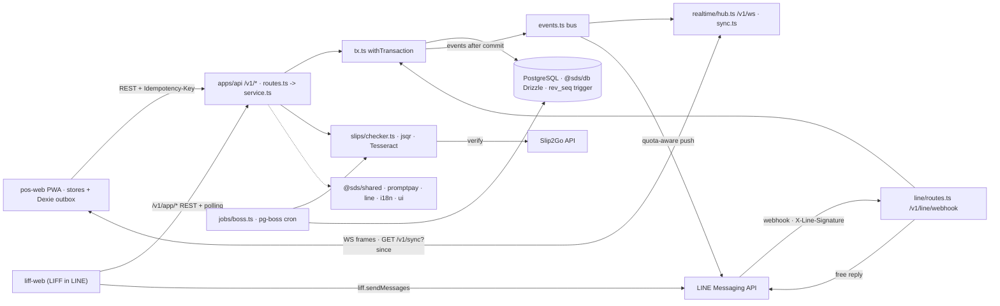

# ARCHITECTURE · code index (as built)
> Verified at `ee9b3b0` (2026-10-17); the pay-first rows (D-38 to D-42, 2026-10-25) were added from the build reports, not re-verified; committed and merged with `main` on `claude/compassionate-franklin-gaz2oh` at `e606513` (chat slips: `line/handlers.ts:handleSlip()` = D-40 allocation + D-41 late slip + D-44 silent drop; one QR reader in `server.ts` for `installSlipScreen` and `installSlipQrReader`). Drift check: `git diff --stat ee9b3b0..HEAD -- apps packages` -> re-verify the rows of every added, renamed or deleted file; `/checkpoint` refreshes rows and this sha. Planned design: `docs/02-architecture.md` (partly stale) · rules: `CLAUDE.md` · folder layout: D-29 in `docs/decisions.md`.
> Search: a root Glob can time out (`node_modules`, untracked `.claude/skills/**`) -> use `git ls-files <dir>` and `git grep -n <symbol> -- apps packages`. No line numbers here: grep the symbol.
> Notation: §4–5 use repo paths. In §3 a bare `file.ts` is in the row's folder and `dir/file.ts` starts at that workspace's `src/`. `file.ts:fn()` = symbol in that file · `->` = calls / flows to · `{a,b}` = each · `GET|POST` = both.

## 1. Monorepo & runtime topology
- **Workspace:** pnpm 12 (`pnpm-workspace.yaml`: `apps/*`, `packages/*`) + Turbo (`turbo.json`: `build`, `typecheck`, `test`) · Node ≥24 runs `.ts` directly · Biome (`biome.json`) · Vitest everywhere, Playwright in `apps/pos-web/e2e` · `packages/config` = `packages/config/tsconfig.base.json` only.
- **API:** `apps/api` = Fastify + `@fastify/cors`, `@fastify/rate-limit`, `@fastify/websocket`; Zod at every route; `@sentry/node`; esbuild bundle (`apps/api/build.ts`) of `apps/api/src/{server,migrate}.ts` and the CLI entries `apps/api/src/cli/{owner-create,owner-reset,owner-unlock,richmenu-upload,slips-to-r2,push-keys}.ts`.
- **Web:** Vite + React. `apps/pos-web` = staff PWA (`vite-plugin-pwa`, `dexie`, `qrcode-generator`). `apps/liff-web` = customer app in LINE (LIFF SDK loaded from LINE's CDN; imports only types from `@sds/shared`, so no Zod in its bundle).
- **Data:** PostgreSQL via `postgres` (postgres.js) + `drizzle-orm`, used only inside `packages/db`; PGlite (`@electric-sql/pglite`) in tests; forward-only SQL in `packages/db/migrations`.
- **Async:** in-process event bus `apps/api/src/events.ts` (published after commit; feeds realtime and LINE pushes); `pg-boss` runs cron jobs only (`apps/api/src/jobs/jobs.ts:JOBS`).
- **External:** LINE Messaging API + webhook (`packages/line`), LIFF ID-token check (`apps/api/src/line/liff-verify.ts`), Slip2Go (`apps/api/src/slips/slip2go.ts`), Tesseract CLI spawned locally (`apps/api/src/slips/ocr.ts`), `jsqr` in a worker thread (`apps/api/src/slips/qr-worker.ts`).

## 2. High-level system & sync flow

## 3. Workspace neural map
### 3A. Shared packages (`packages/*`)
- `@sds/shared` (`packages/shared/src`)
  - **Purpose:** Pure domain core: Zod DTOs, enums, state machines, money.
  - **Key Files & Exports:** `state-machine.ts` (`makeMachine`), `order-machine.ts` (`orderMachine`, `initialOrderStatus`), `payment-machine.ts` (`paymentMachine`, `derivePaymentStatus`), `permissions.ts` (`hasPermission`, `requiresStepUp`, `ROLE_PERMISSIONS`), `money.ts` (`satang`, `sumSatang`, `orderTotals`), `pricing.ts` (`priceOrder`), `cash.ts` (`calculateCashChange`), `gov-copay.ts` (`estimateGovCopaySplit`, `isCopayAvailable`), `payment-adjustment.ts` (`planAdjustment`), `business-date.ts` (`businessDate`), `realtime.ts` (`realtimeFrameSchema`, `syncResponseSchema`, `WS_CLOSE`, `SYNC_SAFETY_REVS`), `slip-verify.ts` (`slip2goVerdict`), `slip-amount.ts` (`extractSlipAmount`, `compareSlipAmount`), `slip-recipient.ts` (`checkSlipRecipient`), `slip-qr.ts` (`parseSlipQr`), `expenses.ts` (`DEFAULT_EXPENSE_CATEGORIES`, `missingCategoryKeys`, `isBuyingGoods`, `buyingGoodsKeys`, `DEFAULT_BUYING_GOODS_KEYS`: the per-category `buyingGoods` flag with a default per key, expense and category Zod schemas), `tax.ts` (`taxReportQuerySchema`, `taxReportSchema`, `taxProfileValueSchema`, `putTaxProfileInputSchema`, `TAX_NOTE_KEYS`), `reports.ts` (also `cashReportQuerySchema`, `cashReportSchema`), `push.ts` (P8 phone alerts: `PUSH_ENDPOINT_HOSTS`, `PUSH_ENDPOINT_HOST_SUFFIXES` (the SSRF allow-list), `isAllowedPushEndpoint`, `pushSubscriptionInputSchema`, `pushConfigResponseSchema`, `pushSubscribedResponseSchema`, `pushPayloadSchema`), `print.ts` (P8 kitchen printing: `buildKitchenTicket` (plain ticket, no phone number, `stripPhoneNumbers` on free text), `kitchenTicketSchema`, `printJobDtoSchema`, `claimPrintJobResponseSchema`, `printAckInputSchema`, `reprintOrderInputSchema`, `PRINT_ERROR_CODES`, `PRINT_LEASE_SECONDS`, `PRINT_MAX_ATTEMPTS`, `printRetryDelaySeconds`, `printingSettingsSchema`, `DEFAULT_PRINTING`, `printingPatchInputSchema`), `settings.ts` (also `cashOpeningSettingsSchema`, `cashOpeningPatchInputSchema`, `DEFAULT_CASH_OPENING`), permission `settings.cash_opening` in `permissions.ts`; Zod/DTO files `orders.ts`, `payments.ts`, `menu.ts`, `settings.ts`, `customer-app.ts`, `auth.ts`, `admin.ts`, `schemas.ts`, `enums.ts`; barrel `index.ts`
  - **Pay-first additions (D-38 to D-42):** `order-merge.ts` (`isPayFirst`, `canCustomerEdit`: new, no claimed or confirmed payment, no slip; `mergeEligible`, `isDuplicateCart`; type imports only, so liff-web reaches it through the subpath `@sds/shared/order-merge`), `slip-allocation.ts` (`allocateSlip` -> `single` | `merge` | `review`), `order-machine.ts` (`new->preparing` also for `system`, `ORDER_REASONS`, `mergedReason()`, `parseOrderReason()`), `customer-app.ts` (edit, cancel, merge, open-orders and needs-combine schemas; slip states `amount_mismatch` and `verified_waiting`; `MyOrder.actions.edit|cancel`, `cancelReason`, `mergedInto`), `settings.ts` (`unpaidTimeoutSettingsSchema`, `DEFAULT_UNPAID_TIMEOUT` {true, 60}), `realtime.ts` (frame `alert.payment` {orderId, orderNo, kind paid|slip_review}, ids only), `OrderDto.paymentMethod` and `needsManualConfirm`
  - **Used by:** `apps/api`, `apps/pos-web`, `apps/liff-web` (types only), `packages/db`, `packages/promptpay`
- `@sds/db` (`packages/db/src`)
  - **Purpose:** Drizzle schema, repository functions, migration runner, PGlite.
  - **Key Files & Exports:** `index.ts` (namespaces `authRepo`, `customersRepo`, `expensesRepo` (`expenses.ts`: `insertExpense`, `lockExpense`, `updateExpenseIfVersion`, `listExpenses`, `findExpenseByClientRequestId`, `findExpenseById`), `invitesRepo`, `lineRepo`, `menuRepo`, `ordersRepo`, `paymentsRepo`, `peopleRepo`, `reportsRepo` (`reports.ts`: `listReportOrders`, paid non-cancelled orders with payments, refunds and live lines; re-exports `report-customers.ts`: `listReportCustomers`, `listCustomerItemUnits`), `pushRepo` (`push.ts`: `upsertForDevice`, `deleteForDevice`, `existsForDevice`, `deleteById`, `listDeliverable` (joins non-revoked devices), `markSuccess`, `recordFailure`), `printRepo` (`print.ts`: `insertJob` (idempotent on order+kind+seq and request id), `nextReprintSeq`, `claimNext` (`FOR UPDATE SKIP LOCKED`), `failExhausted`, `markPrinted`, `releaseForRetry`, `markFailed`, `findById`, `lockById`, `findByClientRequestId`, `listRecent`), `retentionRepo` (`findReferencedSlipKeys` counts a payment slip or an expense receipt as referenced), `syncRepo`, `taxProfilesRepo` (`tax-profiles.ts`: `getTaxProfile`, `lockTaxProfile`, `putTaxProfile`; one row per Buddhist Era year), `schema`; flat re-exports of `audit.ts`, `client.ts`, `settings.ts`), `client.ts` (`createDb`, `runMigrations`, `pingDb`), `audit.ts` (`insertAudit`), `settings.ts` (`getSettingRow`, `updateSettingRowIfVersion`, `getGovCopayRow`), `sync.ts` (`readChanges`, `currentRev`, `SYNC_POLICY`), `uuid7.ts` (`uuidv7`: monotonic UUIDv7 made in the app, the `order_items.id` default, D-45), `pglite.ts` (`createPgliteDb`; import `@sds/db/pglite`), `seed.ts` (`seed`; import `@sds/db/seed`, not in the barrel), `schema.ts` (barrel over `schema/*.ts`, read by `packages/db/drizzle.config.ts`)
  - **Used by:** `apps/api`
- `@sds/promptpay` (`packages/promptpay/src`)
  - **Purpose:** EMVCo PromptPay payload, TLV codec, CRC16 (pure).
  - **Key Files & Exports:** `payload.ts` (`promptpayPayload`, `crc16`, `tlv`, `decodeTlv`, `hasValidCrc`, `formatAmount`); barrel `index.ts`; bank-app scan page `packages/promptpay/scripts/scan-test.ts`
  - **Used by:** `apps/api` (`apps/api/src/payments/{create,read}.ts`), `apps/pos-web` (`apps/pos-web/src/pos/outbox/offline-promptpay-model.ts` only)
- `@sds/finance` (`packages/finance/src`)
  - **Purpose:** report maths, pure, no I/O (P6 reports; P7: margin, commission, P&L, income tax estimate).
  - **Key Files & Exports:** `revenue.ts` (`revenueByDay`, `isCounted`, `keptPayments`, `netPaidSatang`, types `ReportOrder`, `ReportItem`, `ReportPayment`, `ReportRefund`, `DayRevenue`), `items.ts` (`itemSales`), `heatmap.ts` (`heatmap`; weekday from `business_date`, hour from `placed_at` in Asia/Bangkok), `consistency.ts` (`splitInconsistent`: sets aside orders whose refunds exceed their payment), `customers.ts` (`segmentOf`, `segmentSummary`, `favouriteItems`, `LAPSED_AFTER_DAYS`, `REGULAR_MIN_ORDERS`), `margin.ts` (`periodMargin`, `orderCost`), `commission.ts` (`platformCommission`), `overlap.ts` (`foodCostOverlap`, `platformFeesOverlap`: when both of a pair are above 0 only the LARGER is deducted, cost of goods vs `ingredients` expenses and commission vs `platform_fees` expenses; returns `basis` and `notDeductedSatang`; one helper for P&L and tax), `pnl.ts` (`profitAndLoss`: revenue - cost of goods - commission - unvoided expenses + the two not-deducted overlaps, `foodCostBasis`/`platformFeesBasis`, `complete` flag, per-month rows that apply the larger-of rule to their own month, gov co-pay revenue; D-33), `tax.ts` (`estimateTax` (actual expenses use the same larger-of rule, answer carries `foodCostBasis`, `platformFeesBasis` and the not-deducted amounts), `bracketTax`, `payableTax`, `incomingPromptpayTransfers`, types `TaxInput`, `TaxEstimate`; income tax estimator for a 40(8) sole trader, half-year ภ.ง.ด.94 and annual ภ.ง.ด.90, 60% flat vs actual, 0.5% comparison, filing, VAT and e-Payment watches; D-34), `tax-rules/` (the rules as DATA per Buddhist Era year: `types.ts` `TaxRules`, `th-pit-2569.ts`, `registry.ts` `TAX_RULES`, `taxRulesFor`, `taxYearsAvailable`; a new year is a new file plus one line in the registry, no estimator change), `cash.ts` (`cashReport`, `addIsoDays`, `DEFAULT_PURCHASE_CATEGORIES`: receipts and payments per business day, receipts of ALL methods from `keptPayments` so they tie to revenue, unvoided expenses split into buying goods (the flagged categories, `purchaseCategories`) and other, `netSatang` per day and a running net from the owner's start amount (`runningNetSatang`, not a bank balance) with a brought-forward net, `reconciliation`; D-35), `csv.ts` (`toCsv`, `CSV_BOM`, `satangDecimal`, `revenueCsvRows`, `itemsCsvRows`, `cashCsvRows`); barrel `index.ts`
  - **Used by:** `apps/api` (`apps/api/src/reports/service.ts`)
- `@sds/line` (`packages/line/src`)
  - **Purpose:** LINE wire layer: signature, events, router, Flex, sender.
  - **Key Files & Exports:** `signature.ts` (`verifySignature`), `events.ts` (`webhookBodySchema`, `eventUserId`), `router.ts` (`routeEvent`, `KEYWORDS`), `postback.ts` (`encodePostback`, `parsePostback`), `flex.ts` (`orderConfirmation`, `paymentInstructions`, `methodPicker`, `orderStatusCard`, `readyCard`, `receiptCard`, `followGreeting`, `botText`), `sender.ts` (`createLineSender`: `reply`, `push`), `client.ts` (`createLineClient`), `policy.ts` (`parseLinePolicy`, `quotaMonth`, `thresholdsReached`), `order-text.ts` (`orderPlacedText`, `parseOrderPlacedText`), `richmenu.ts` (`loadRichMenu`, `DEFAULT_RICH_MENU`), `richmenu-upload.ts` (`uploadRichMenu`)
  - **Used by:** `apps/api` (`apps/api/src/line/`, `apps/api/src/cli/richmenu-upload.ts`), `apps/liff-web` (`@sds/line/order-text` only)
- `@sds/i18n` (`packages/i18n/src`)
  - **Purpose:** th/en catalogs, translator, baht and Buddhist-Era formatters.
  - **Key Files & Exports:** `translate.ts` (`t`, `translator`, `LOCALES`, `DEFAULT_LOCALE`), `th.ts` (`th`, `MessageKey`; barrel over `th/*.ts`, incl. `th/reports.ts` for report, export and tax-estimate text `tax.disclaimer`, `tax.status.proposed`, `tax.note.*`), `en.ts` (`en`; barrel over `en/*.ts`), `format.ts` (`formatBaht`, `formatDate`, `DISPLAY_TIME_ZONE`), `receipt.ts` (`receiptHtml`, `receiptFileName`); a new catalog part must be added to `catalog-parts.test.ts`
  - **Used by:** `apps/pos-web`, `apps/liff-web`, `packages/line`, `apps/api` (`reports/export.ts`, Thai CSV headers)
- `@sds/ui` (`packages/ui/src`)
  - **Purpose:** Design tokens, theme resolver, CSS variables, contrast checks.
  - **Key Files & Exports:** `tokens.ts` (`baseTokens`, `darkOverrides`, `deviceDefaults`, `DEVICES`, `ChartTokens`: `chart.series1..5` fixed categorical slots and `chart.heat1..4`, validated with the data-viz script), `resolve.ts` (`resolveTokens`), `css.ts` (`toCssVariables`, `CSS_VAR_PREFIX`), `contrast.ts` (`contrastRatio`), `brand.ts` (`defaultBrand`); CSS `tokens.css`, `glass.css`, `design.css`; generator `packages/ui/scripts/generate-tokens-css.ts`
  - **Used by:** `apps/pos-web` (`apps/pos-web/src/main.tsx`, `apps/pos-web/src/theme/`), `apps/liff-web`
- `@sds/escpos` (`packages/escpos/src`, P8 slice 2; pure: no file or network I/O)
  - **Purpose:** Draws a kitchen ticket as a 1-bit raster image and wraps it in ESC/POS bytes. Thai is shaped by fontkit (the font's own GSUB/GPOS, so tone marks and vowels stack correctly) from bundled Sarabun (SIL OFL 1.1, base64 in `fonts.generated.ts`, sources and licence in `packages/escpos/fonts/`); an own scanline filler (`rasterize.ts`) paints glyph outlines, then a threshold (no halftones).
  - **Key Files & Exports:** `ticket.ts` (`renderTicket(ticket, {widthDots: 576|512|384, cut, threshold, bandHeight})` -> `Uint8Array` = `ESC @` + `GS v 0` bands + `GS V 66 0` cut; `ticketBitmap`, `drawTicket`, `SUPPORTED_WIDTHS`; 576 is a default to confirm on the real XP-80T), `bitmap.ts` (`Bitmap`, `encodeRaster`, `INIT_PRINTER`, `FEED_AND_CUT`, optional status helpers `statusQuery`, `isOfflineStatus`, `isCoverOpenStatus`, `isPaperEndStatus`), `canvas.ts` (`Canvas`, `DEFAULT_THRESHOLD`), `fonts.ts` (`shapeText`, `measureText`), `wrap.ts` (`wrapText`: ICU Thai word breaks, grapheme fallback), `labels.ts` (`channelBadge`, `fulfillmentLabel` read `@sds/i18n` Thai keys `orders.channel.*` and `pos.orderEntry.fulfilment.*`; `TICKET_TEXT`, `thaiDate`: ticket-only words not yet in i18n), `sample.ts` (`SAMPLE_TICKET`, made-up data); `scripts/embed-fonts.ts` (`pnpm --filter @sds/escpos fonts:embed`), `scripts/preview.ts <out-dir>` (manual PNG preview, writes nothing in the repo)
  - **Used by:** `apps/print-agent`; takes `KitchenTicket` from `@sds/shared`, words from `@sds/i18n`

### 3B. Backend vertical slices (`apps/api/src/*`)
- `Auth + admin` (`apps/api/src/{auth,admin}`)
  - **Purpose:** Device tokens, PIN/owner sign-in, sessions, step-up, staff/device admin.
  - **Routes/Entry:** `auth/routes.ts` (`POST /v1/auth/{device,pin,owner,step-up,logout,invite/preview,invite/accept}`, `GET /v1/auth/{staff,me}`), `admin/routes.ts` (`GET /v1/devices`, `POST /v1/devices/:id/{revoke,outbox-recovery}`, `GET|POST /v1/staff`, `PATCH /v1/staff/:id`, `POST /v1/staff/:id/{role,pin}`, `GET|POST /v1/staff/invites`, `POST /v1/staff/invites/:id/revoke`) -> **Logic:** `auth/devices.ts:registerDevice()`, `auth/pin.ts:pinLogin()`, `auth/owner-login.ts:ownerLogin()`, `auth/sessions.ts:issueSession()`, `auth/step-up.ts:stepUp()`, `auth/invite-accept.ts:acceptInvite()`, `auth/guards.ts:createGuard()`, `admin/service.ts:createStaffMember()`, `admin/invites.ts:createInvite()` -> **DB Tables:** `staff`, `owner_credentials`, `devices`, `sessions`, `staff_invites`, `audit_log`
  - **Depends on:** `@sds/shared` (`permissions.ts`, `auth.ts`, `admin.ts`), `@sds/db` (`authRepo`, `peopleRepo`, `invitesRepo`, `insertAudit`), `auth/crypto.ts` (`hashPin`, `verifyPassword`, `newToken`), `auth/totp.ts:verifyTotp()`, `auth/policy.ts:DEFAULT_AUTH_POLICY`; import surface `auth/service.ts`
- `Orders` (`apps/api/src/orders`)
  - **Purpose:** Create, list, move, correct, void and receipt orders.
  - **Routes/Entry:** `routes.ts` (`POST|GET /v1/orders`, `GET /v1/orders/summary`, `GET|PATCH /v1/orders/:id`, `POST /v1/orders/:id/{transition,cancel,receipt,void}`, `PATCH /v1/orders/:id/correction`), `recipients.ts` (`GET /v1/recipients`) -> **Logic:** `service.ts:createOrder()`, `transitionOrder()`, `patchOrder()`, `listOrdersForDay()`, `summarizeOrdersForMonth()`, `correction.ts:correctOrder()`, `voidOrder()`, `receipt.ts:issueReceipt()`, `dto.ts:toOrderDto()` -> **DB Tables:** `orders`, `order_items`, `daily_counters`, `payments`, `customers`, `settings`, `audit_log`
  - **Depends on:** `@sds/shared` (`order-machine.ts`, `pricing.ts`, `business-date.ts`), `@sds/db` (`ordersRepo`, `customersRepo`, `insertAudit`), `payments/service.ts` (`settlePaymentsForOrderCancel`), `line/order-change-push.ts:notifyOrderChange()` (callback wired in `v1.ts`), `request-hash.ts:orderRequestHash()`, `business-day.ts:currentBusinessDate()`
- `Payments` (`apps/api/src/payments`)
  - **Purpose:** Create, claim, confirm, change method, void, refund; PromptPay QR.
  - **Routes/Entry:** `routes.ts` (`POST|GET /v1/orders/:id/payments`, `POST /v1/payments/:id/{claim,confirm,cancel-claimed,change-method,void,refund,slip-recheck,slip-block/clear}`, `GET /v1/payments/:id/{slip,qr-url,qr.png}` (`qr.png?...&download=1` adds `Content-Disposition: attachment`, outside the signed proof)) -> **Logic:** `create.ts:createPayment()`, `moves.ts:movePayment()`, `change-method.ts:changePaymentMethod()`, `auto-confirm.ts:autoConfirmClaimedPayment()`, `read.ts:paymentQrUrl()`, `renderPaymentQr()`, `order-hooks.ts:settlePaymentsForOrderCancel()`, `internal.ts:settleOrder()`, `emitPayment()`; the slip routes call `slips/service.ts` -> **DB Tables:** `payments`, `payment_refunds`, `orders`, `gov_copay_schemes`, `settings`, `audit_log`
  - **Depends on:** `@sds/shared` (`payment-machine.ts`, `cash.ts`, `gov-copay.ts`, `payment-adjustment.ts`), `@sds/promptpay` (`promptpayPayload`), `@sds/db` (`paymentsRepo`, `ordersRepo`), `qr.ts` (`signQrLink`, `qrPng`), `request-hash.ts:paymentRequestHash()`, `line/payment-rejected-push.ts:notifyPaymentRejected()`; import surface `service.ts`
- `Slips` (`apps/api/src/slips`)
  - **Purpose:** Slip files, QR/OCR reading, Slip2Go check queue.
  - **Routes/Entry:** no routes of its own: `service.ts:attachSlip()` (from `customer-app/routes.ts`, `line/handlers.ts`), `recheckSlip()`, `clearSlipBlock()`, `readSlip()` (from `payments/routes.ts`); installed by `server.ts` via `checker.ts:installSlipChecker()`, `slip2go.ts:installSlipVerifier()` -> **Logic:** `checker.ts:createSlipChecker()` (`enqueue`, `sweep`, `recheck`, `evaluate`, `readOcr`, `readVerify`), `slip2go.ts:createSlip2goVerifier()` (`verifyQr`, `verifyImage`), `qr.ts:createWorkerQrReader()` (`readRaw`) -> `qr-worker.ts` -> `qr-decode.ts:readSlipQrText()`, `ocr.ts:createTesseractOcr()`, `guard.ts:slipUploadRefusal()`, `store.ts:createFsSlipStore()` / `createMemorySlipStore()` (the `SlipStore` seam: `put`, `get`, `delete`, `list` with `size`), `r2-store.ts:createR2SlipStore()` (Cloudflare R2 over S3 with `sigv4.ts:signRequest()`; prefixes `R2_SLIP_PREFIX` `slips/`, `R2_RECEIPT_PREFIX` `receipts/`; chosen in `server.ts` when `config.r2` is set, D-36), `copy-to-r2.ts:copySlipsToTarget()` (one-off disk to R2 copy, dry run by default, driven by `cli/slips-to-r2.ts` = `dist/slips-to-r2.js --apply`) -> **DB Tables:** `payments`, `slip_verify_daily`, `orders`, `customers`, `audit_log`
  - **Depends on:** `@sds/shared` (`slip-verify.ts`, `slip-amount.ts`, `slip-recipient.ts`, `slip-ref.ts`, `slip-qr.ts`), `payments/service.ts:autoConfirmClaimedPayment()`, Slip2Go API, `jsqr` + `jpeg-js` + `pngjs`, Tesseract CLI; env `SLIP_VERIFIER`, `SLIP_OCR`, `SLIP_QR`, `SLIP_AUTOCONFIRM`, `R2_ACCOUNT_ID`, `R2_ACCESS_KEY_ID`, `R2_SECRET_ACCESS_KEY`, `R2_BUCKET` (all four or none; `config.ts`). Test fake: `test-support/fake-s3.ts:startFakeS3()`
- `Customer app` (`apps/api/src/customer-app`)
  - **Purpose:** LIFF customer API: session, checkout, orders, payment, slip.
  - **Routes/Entry:** `routes.ts` (`POST /v1/app/session`, `GET /v1/app/checkout`, `GET|PUT /v1/app/member`, `POST /v1/app/privacy-ack`, `POST|GET /v1/app/orders`, `GET /v1/app/orders/:id`, `POST /v1/app/orders/:id/{payment,claim,slip}`, `GET /v1/app/orders/:id/{slip,qr}`) -> **Logic:** `service.ts:openSession()`, `placeOrder()`, `selectPayment()`, `claimPayment()`, `myQr()`, `viewOrder()`, `checkoutInfo()`, `session.ts:createCustomerGuard()`, `signCustomerToken()` -> **DB Tables:** `customers`, `orders`, `order_items`, `payments`
  - **Depends on:** `line/liff-verify.ts:createLiffVerifier()` (LIFF token -> LINE), `orders/service.ts:createOrder()`, `payments/service.ts` (`createPayment`, `movePayment`, `changePaymentMethod`), `slips/service.ts:attachSlip()`, `slips/guard.ts`, `@sds/shared` (`customer-app.ts`)
- `Customers` (`apps/api/src/customers`)
  - **Purpose:** Staff-side slip flag and PDPA anonymize per customer.
  - **Routes/Entry:** `routes.ts` (`GET /v1/customers/:id/slip-flag`, `POST /v1/customers/:id/{slip-flag/clear,anonymize}`) -> **Logic:** `service.ts:getSlipFlag()`, `clearSlipFlag()`, `anonymizeCustomer()` -> **DB Tables:** `customers`, `orders`, `payments`, `audit_log`
  - **Depends on:** `@sds/db` (`customersRepo`, `ordersRepo`, `insertAudit`), `slips/store.ts` (slip files), `@sds/shared` (`customers.ts`)
- `Menu` (`apps/api/src/menu`)
  - **Purpose:** Public menu, staff CRUD, availability, photos, sort order.
  - **Routes/Entry:** `routes.ts` (`GET /v1/menu`, `GET /v1/menu/costs`, `POST /v1/menu/reorder`, `GET|POST /v1/menu/{categories,items,modifier-groups}`, `GET /v1/menu/items/:id`, `PATCH|DELETE /v1/menu/{categories,items,modifier-groups,modifier-options}/:id`, `PUT|GET|DELETE /v1/menu/items/:id/photo`, `PATCH /v1/menu/{items,modifier-options}/:id/availability`, `POST /v1/menu/modifier-groups/:groupId/options`) -> **Logic:** `reads.ts:publicMenu()`, `listItems()`, `listCosts()`, `items.ts:createItem()`, `patchItem()`, `setItemAvailability()`, `categories.ts:createCategory()`, `groups.ts:createGroup()`, `createOption()`, `photos.ts:setItemPhoto()`, `reorder.ts:reorder()`, `internal.ts:publish()` -> **DB Tables:** `menu_categories`, `menu_items`, `menu_item_photos`, `menu_item_channel_prices`, `modifier_groups`, `modifier_options`, `menu_item_modifier_groups`, `audit_log`
  - **Depends on:** `@sds/db` (`menuRepo`, `syncRepo`, `insertAudit`), `@sds/shared` (`menu.ts`, `image.ts`), `request-hash.ts:menuRequestHash()`, `dto.ts:itemDto()`; import surface `service.ts` (also used by `realtime/frames.ts`)
- `Expenses` (`apps/api/src/expenses`)
  - **Purpose:** Expense ledger (P7): create, correct, void, list by business date; the owner's editable category list.
  - **Routes/Entry:** `routes.ts` (`GET|POST /v1/expenses`, `PATCH /v1/expenses/:id`, `POST /v1/expenses/:id/void`, `GET|PUT /v1/expenses/categories`; all `expense.edit` = owner and manager; no DELETE of an expense) plus the receipt photo (D-36, same permission): `POST /v1/expenses/:id/receipt?expectedVersion=` (raw JPEG/PNG body, `Idempotency-Key` header required, 201, replay 200), `GET /v1/expenses/:id/receipt` (audited `expense.receipt.view`), `DELETE /v1/expenses/:id/receipt?expectedVersion=` -> **Logic:** `service.ts` barrel: `expenses.ts:createExpense()` (replay by `clientRequestId` + `request-hash.ts:expenseRequestHash()`), `patchExpense()`, `voidExpense()`, `listExpenses()`; `receipt.ts:attachReceipt()` (replay check before the version check; file written first, removed if the commit fails, replaced file removed after it), `removeReceipt()`, `readReceipt()`; `receipt-image.ts:prepareReceiptImage()` (pure JS `jpeg-js`+`pngjs`: EXIF orientation applied then dropped, longest side 1280, about 200 KB JPEG, WebP refused, caps `MAX_RECEIPT_BYTES` 10 MB and `MAX_RECEIPT_PIXELS` 26 MP, one at a time); `categories.ts:readCategories()`, `putCategories()`, `assertCategoryActive()` (settings key `expense_categories`, keys are switched off never removed) -> **DB Tables:** `expenses` (`receipt_image_key`, `receipt_request_id`, `receipt_request_hash`), `settings`, `audit_log`; the receipts live in their own `SlipStore` passed to `registerExpenseRoutes()` (no job deletes from it); event `expense.upserted` after commit (no device frame yet: `realtime/frames.ts` ignores it)
  - **Depends on:** `@sds/db` (`expensesRepo`, `getSettingRow`, `insertAudit`), `@sds/shared` (`expenses.ts`), `orders/business-day.ts:currentBusinessDate()`
- `Reports` (`apps/api/src/reports`)
  - **Purpose:** Read-only report endpoints (P6, `report.view`; the P&L from P7, owner only via `finance.pnl`).
  - **Routes/Entry:** `routes.ts` (`GET /v1/reports/{revenue,items,heatmap}?from&to`, range at most 366 days, `report.view`; `GET /v1/reports/pnl?from&to`, same range, owner only via `finance.pnl` (no step-up); `GET /v1/reports/tax?year&period=annual|half` (year is B.E.; owner only via `finance.pnl`, no step-up; 422 `TAX_RULES_NOT_AVAILABLE` for a year with no rules file); `GET /v1/reports/cash?from&to[&emptyDays=true]` (cash receipts and payments, owner only via `finance.pnl`, no step-up, D-35); `GET /v1/reports/customers`, owner only via `customer.report`; `GET /v1/reports/export/{revenue,items,cash}.csv`, owner only via `data.export` with step-up, audited) -> **Logic:** `service.ts:loadReportOrders()` (one shared load per range while it runs, minus inconsistent orders), `revenueReport()`, `pnlReport()`, `cash.ts:cashReport()` (orders + expenses of the range + `currentCashOpening()`, `expenses/categories.ts:currentBuyingGoodsKeys()`; when the range starts after the opening day it first sums the net (receipts minus payments) of the days between in windows of at most 366 days with the same `@sds/finance` function; parsed with `cashReportSchema`), `tax.ts:taxReport()` (P&L of the period incl. its ingredients and platform_fees totals + `tax_profiles` row + PromptPay payments -> `estimateTax`), `itemsReport()`, `heatmapReport()`, `customersReport()`, `export.ts:exportCsv()`
  - **Depends on:** `@sds/db` (`reportsRepo.listReportOrders`, `expensesRepo.listExpenses`), `taxProfilesRepo.getTaxProfile`, `@sds/finance` (`revenueByDay`, `splitInconsistent`, `profitAndLoss`, `cashReport`, `estimateTax`, `taxRulesFor`), `apps/api/src/settings/service.ts:currentPlatformCommission()`, `@sds/shared` (`reports.ts`: `revenueReportQuerySchema`, `revenueReportSchema`, `pnlReportSchema`, `reportRangeDays`, `REPORT_MAX_DAYS`; `tax.ts`: `taxReportQuerySchema`, `taxReportSchema`)
- `Settings` (`apps/api/src/settings`)
  - **Purpose:** Versioned shop settings resources and the co-pay scheme.
  - **Routes/Entry:** `routes.ts` (`GET|PATCH /v1/settings/{shop,opening-hours,line-ordering,numbering,payments,delivery,printing,promptpay,receipt,bank-account,platform-commission,gov-copay}` (`printing` = `{enabled}`, default off, read `settings.view`, change `settings.edit` = manager and owner, no step-up, generic `settings.update` audit, not on the realtime feed; `service.ts:currentPrintingEnabled()`), `PUT /v1/settings/delivery`; `GET|PATCH /v1/settings/cash-opening` (start amount `{amountSatang, asOf}` of the cash report; read `finance.pnl`, change `settings.cash_opening` = owner, step-up, audited `settings.cash_opening_change`, alerted, never on the realtime feed, key not in `SYNCED_SETTING_KEYS`; `service.ts:currentCashOpening()`), `GET|PUT /v1/settings/tax-profile?year` (B.E. year; the owner's extra allowances and method preference, whole profile replaced; read = `finance.pnl` owner only, save = `settings.tax_profile` owner with step-up, audited `settings.tax_profile_update`; `tax-profile.ts:readTaxProfile()`, `putTaxProfile()`); `platform-commission` = Grab and LINE MAN rate in basis points, null until the owner sets it; READ is owner only too (`Resource.viewPermission: 'finance.pnl'`, 403 for manager/cashier/kitchen; `toResponse` also masks it for any non-owner), change = `settings.platform_commission` owner only with step-up, audited, alerted, not on the feed; the tax-profile PUT takes no `expectedVersion`, the owner can save at any time) -> **Logic:** `service.ts:RESOURCES`, `readSetting()`, `patchSetting()`, `readGovCopay()`, `patchGovCopay()`, `currentPromptpayId()`, `currentOpeningHours()`, `lineOrderingNow()` -> **DB Tables:** `settings`, `gov_copay_schemes`, `audit_log`
  - **Depends on:** `@sds/db` (`getSettingRow`, `updateSettingRowIfVersion`, `getGovCopayRow`, `updateGovCopayRowIfVersion`), `@sds/shared` (`settings.ts`), `auth/service.ts` (`securityAlert`)
- `LINE` (`apps/api/src/line`)
  - **Purpose:** Webhook intake, chat handlers, LIFF token check, quota pushes.
  - **Routes/Entry:** `routes.ts` (`POST /v1/line/webhook`, `GET /v1/line/quota`), bus subscriber `completion-push.ts:registerCompletionPush()`, job `retry.ts:retryLineEvents()` -> **Logic:** `handlers.ts:handleEvent()`, `handleOrderPlaced()`, `handleSlip()`, `runtime.ts:createLineRuntime()`, `buildSender()`, `dbQuotaStore()`, `stored-route.ts:toStoredRoute()`, `order-change-push.ts:notifyOrderChange()`, `payment-rejected-push.ts:notifyPaymentRejected()`, `liff-verify.ts:createLiffVerifier()`, `liff-health.ts:createLiffHealth()`, `receipt.ts:receiptItems()` -> **DB Tables:** `line_events`, `line_button_replies`, `line_message_log`, `line_quota_months`, `customers`, `orders`, `payments`
  - **Depends on:** `@sds/line`, `@sds/db` (`lineRepo`, `ordersRepo`, `paymentsRepo`), `customer-app/service.ts` (`viewOrder`, `selectPayment`, `claimPayment`), `slips/service.ts:attachSlip()`, `settings/service.ts` (`currentPromptpayId`), LINE Messaging API
- `Print` (`apps/api/src/print`, P8 slice 1: server queue; the print program is `apps/print-agent`, drawing is `packages/escpos`)
  - **Purpose:** Kitchen print queue the notebook's print program PULLS from over HTTPS; reprint; recent-jobs list.
  - **Routes/Entry:** `routes.ts:registerPrintRoutes()` (mounted at `/v1` with no prefix) = `POST /v1/print/claim` (short poll: `{job: null}` or the job with its ticket and a 30 s lease; send `{}` as body) and `POST /v1/print/jobs/:id/ack` (`{leaseToken, result: 'printed'}` or `{..., result: 'failed', errorCode}`), both behind `auth/guards.ts:createPrintAgentGuard()` (`x-device-token` of a non-revoked `print_agent` device; no staff session; `markPrintAgentGuard`/`hasPrintAgentGuard`, accepted by `enforceGuardedRoutes`); staff `GET /v1/print/jobs?limit` (any signed-in staff, no ticket) and `POST /v1/orders/:id/reprint` (`order.create` = cashier, manager, owner; body `{clientRequestId}`; 201 new job, 200 replay, 409 `PRINTING_OFF`) -> **Logic:** `service.ts:enqueueKitchenJob()`, `claimPrintJob()` (first `failExhausted()` + alert, then `printRepo.skipCancelledOrders()` = waiting `kitchen` jobs of a cancelled order become `failed` / `ORDER_CANCELLED` with no alert (a `reprint` is left alone, so a reprint of a cancelled order still prints), then `claimNext()`, ticket built here and never stored), `ackPrintJob()` (printed = idempotent and accepted even after the lease moved; failed needs the lease token, retries with `printRetryDelaySeconds()` back-off, at `PRINT_MAX_ATTEMPTS` becomes `failed` + `alert.security` kind `print.job_failed`), `reprintOrder()` (order row lock gives each reprint its own `seq`), `listPrintJobs()`; `kitchen-queue.ts:registerKitchenQueue()` = bus subscriber for `order.sent_to_kitchen` (emitted by `orders/service.ts` in `createOrder()` when the order starts `preparing` and in `transitionOrder()` when `to` is `preparing`, so LINE and platform orders print on accept) that inserts one `kitchen` job when settings key `printing` is on; its failure is logged by the bus and never reaches the order write -> **DB Tables:** `print_jobs` (migration 0040, `last_error` CHECK widened by 0042 for `ORDER_CANCELLED`; not synced: no rev/version), `orders`, `order_items`, `settings`, `audit_log` (`print.reprint`)
  - **Depends on:** `@sds/db` (`printRepo`, `ordersRepo`, `insertAudit`), `@sds/shared` (`print.ts`), `settings/service.ts:currentPrintingEnabled()`, `orders/dto.ts:toOrderDto()`; `v1.ts:registerV1()` returns `{idle}` and `test-support/harness.ts` `settle()` waits on it. At-least-once: a lost ack after a real print can print twice, so the print program must remember printed job ids
- `Push` (`apps/api/src/push`, P8 slice 4a: server side of phone alerts; D-37 Web Push, no library, no third party besides the browsers' push services; kept here, not in `packages/notify`, for this slice)
  - **Purpose:** One encrypted alert to every opted-in device when an order is created; per-device on/off.
  - **Routes/Entry:** `routes.ts:registerPushRoutes()` at `/v1/push` (all behind `guard()`, any signed-in staff on a registered device, `no-store`): `GET /config` (`{enabled, publicKey}`, 200 even when unconfigured), `GET|PUT|DELETE /subscription` (`{subscribed}`; the device is the session's device, not the body; 403 `DEVICE_REQUIRED` for a session with no device; 400 for a host outside the allow-list or a key that is not a P-256 point; 503 `PUSH_NOT_CONFIGURED` when VAPID is not set) -> **Logic:** `notifier.ts:registerPushNotifier()` = bus subscriber for `alert.new_order` (published after the order commit; chosen over `order.sent_to_kitchen` so a LINE order that waits for acceptance also alerts; skips the device the order was typed on, `createdOnDeviceId`) that sends to `pushRepo.listDeliverable()` with bounded concurrency (5) and a per-send timeout (10 s), TTL 120 s, urgency high; 404/410 delete the row, 400/401/403/413 are logged and not counted, 429/5xx/timeout/network count toward `maxFailures` (5) then the row is deleted; never throws into the order write; `payload.ts:newOrderPayload()` (title `ออเดอร์ใหม่ #L-012 (LINE)`, body `N รายการ`, `url` `/#/orders/<id>`, tag `order-<id>`: no name, phone, room, address or note), `webpush.ts` (`encryptPayload` RFC 8291 aes128gcm, `vapidAuthorization` RFC 8292 ES256 with `ieee-p1363`, `buildPushRequest`, `createFetchTransport` with `redirect: 'error'`, `generateVapidKeys`, `vapidPublicKeyOf`, `isValidSubscriberKey`), `vapid-file.ts:writeVapidFile()` (driven by `cli/push-keys.ts` = `pnpm --filter @sds/api push:keys`, prints only the public key); `admin/service.ts:revokeDevice()` deletes the device's subscription in its transaction -> **DB Tables:** `push_subscriptions` (migration 0041; one row per device; endpoint and keys never returned or logged)
  - **Depends on:** `@sds/db` (`pushRepo`, `ordersRepo`), `@sds/shared` (`push.ts`), `@sds/i18n` (channel names); env `VAPID_PUBLIC_KEY`, `VAPID_PRIVATE_KEY`, `VAPID_SUBJECT` (all three or none; `config.vapid`; the pair must match); `v1.ts` `V1Deps.push` (`PushRuntime`: `vapid`, test-only `transport`, `timeoutMs`, `maxFailures`, `concurrency`) and `registerV1().idle()` waits on it. Test fakes: `test-support/fake-push.ts` (`createFakePush`, `newBrowser` decrypts what was sent, `TEST_VAPID`)
- `Realtime` (`apps/api/src/realtime`)
  - **Purpose:** WebSocket fan-out of bus events; rev-paged catch-up.
  - **Routes/Entry:** `routes.ts:setupRealtime()`, `registerRealtimeRoutes()` (`GET /v1/ws` upgrade, `GET /v1/sync`) -> **Logic:** `hub.ts:createHub()` (`accept`, `authenticate`, `onEvent`), `frames.ts:frameFromEvent()`, `mayReceive()`, `frameForRole()`, `frameFromEntry()`, `sync.ts:createCatchUp()` -> **DB Tables:** every `SYNCED_TABLES` table via `syncRepo` (read only)
  - **Depends on:** `events.ts` (bus), `auth/service.ts:peekSession()`, `@sds/shared` (`realtime.ts`), `@fastify/websocket`, `menu/service.ts` (DTO mappers); tests use `test-helpers.ts`
- `Jobs` (`apps/api/src/jobs`)
  - **Purpose:** pg-boss cron: retention, LINE retry, slip sweep, Slip2Go check.
  - **Routes/Entry:** `boss.ts:startJobs()`, started by `server.ts` through `supervisor.ts:superviseJobs()` -> **Logic:** `jobs.ts:JOBS` (`line-events-retry`, `slip-check-sweep`, `slip2go-account-check`, `retention-*`, `print-agent-silent-check` (every 2 min) = `print-agent-silent.ts:checkPrintAgentSilent()`: printing on and a job no print program ever claimed (`pending`, 0 attempts, `printRepo.countUnclaimedSince()`) for 3 min -> one `alert.security` kind `print.agent_silent` warn, no ids; in-memory dedupe: again after 30 min or once the queue was clear, nothing while printing is off, `storage-usage-check` = `storage-usage.ts:checkStorageUsage()`: sums bytes and files of the slip and receipt stores, `storage.quota_high` warn alert above 70% of the free 10 GB; `JobDeps.receipts`), `retention.ts:anonymizeOrders()`, `purgeSlips()`, `sweepOrphanSlips()`, `slip2go.ts:checkSlip2goAccount()` -> **DB Tables:** `orders`, `payments`, `customers`, `devices`, `staff_invites`, `line_events`, `line_button_replies` (+ pg-boss's own schema)
  - **Depends on:** `pg-boss`, `@sds/db` (`retentionRepo`), `line/retry.ts:retryLineEvents()`, `slips/checker.ts:activeSlipChecker()`, `slips/slip2go.ts:activeSlipVerifier()`, `alerts.ts`

- `Pay-first orders` (D-38 to D-42, built 2026-10-25, uncommitted; files sit in the Orders, Payments, Slips, Customer app, Jobs and Settings folders)
  - **Purpose:** LINE PromptPay orders reach the kitchen and printer only once paid; customers edit, cancel and merge unpaid orders in the app; a chat slip with several open orders is allocated by amount; unpaid orders are cancelled after a timeout.
  - **Routes/Entry:** `customer-app/routes.ts` adds `GET /v1/app/orders/open`, `PUT /v1/app/orders/:id/items`, `POST /v1/app/orders/:id/{cancel,merge}` (customer guard, `Idempotency-Key` required), and `POST /v1/app/orders/:id/slip` takes `?combine=1` | `?review=1` and answers 409 `NEEDS_COMBINE` with `details` (nothing stored); `GET|PATCH /v1/settings/unpaid-timeout` (copy of `printing`); transition body field `startUnpaid` + `reason` (manager and owner only; staff accept of an unpaid pay-first order is otherwise 409 `PAYMENT_REQUIRED`) -> **Logic:** `orders/customer-edit.ts:editOrderItems()`, `cancelByCustomer()`, `mergeOrders()` (also called with the system actor; one transaction, orders locked in id order, sources cancelled with `merged:<no>`, one pending payment for the new total), `payments/internal.ts:settleOrder()` (a paid pay-first order goes `new->preparing` in the same transaction, so `order.sent_to_kitchen` prints it; stores `orders.payment_method` and `needs_manual_confirm`), `payments/alerts.ts` (publishes `alert.payment`: `paid` once, `slip_review` once per payment and picture), `slips/allocate.ts` (chat slip: candidates oldest first, `SlipChecker.readLocalAmount` (OCR only) -> `allocateSlip`), `slips/app-slip.ts` (LIFF upload route logic), `slips/late.ts:keepLateSlip()` (a slip for an order cancelled by the timeout in the last 24 h is kept for staff review on the cancelled payment, never auto-confirmed), `jobs/unpaid-timeout.ts` (every 5 min; candidates from `ordersRepo.listNewLineOrdersPlacedBefore()` = LINE `new` orders with a `pending` PromptPay payment (M4); `orders/service.ts:cancelUnpaidOrder()`, actor system, reason `unpaid_timeout`, no LINE message), `payments/auto-confirm.ts` (refuses when `slip_autoconfirm_blocked`) -> **DB Tables:** `payments.slip_autoconfirm_blocked` (migration 0044, with the partial unique index `payments_slip_qr_confirmed_key` on `slip_qr_hash` where `status='confirmed'`: PAY-06), `orders.payment_method`, `orders.needs_manual_confirm` (migration 0043)
  - **Depends on:** `@sds/shared` (`order-merge.ts`, `slip-allocation.ts`), `orders/correction.ts` line-retire logic (`removed_at`), `createPayment`, `settlePaymentsForOrderCancel`. On the VM `SLIP_OCR` is off, so the local amount is null and a chat slip with 2+ open orders always goes to staff review; the merge and match paths run only with OCR on (tested with a fake)
- `Telegram` (`apps/api/src/telegram`, D-42; same shape as `Push`)
  - **Purpose:** One Telegram message (or album) to the owner's private staff group on `alert.payment`.
  - **Routes/Entry:** `notifier.ts:registerTelegramNotifier()` (bus subscriber; reloads the order and live lines; `sendMediaGroup` with the LINE picture and up to 9 dish photos, `sendPhoto` for one picture, text fallback when media fails; 10 s timeout; one retry on 429/5xx; 2 at a time; the same order and kind inside 2 min is sent once; never throws into the write path), `message.ts` (plain text from a fixed allow-list: LINE name, order name, building, dishes, total; no phone, room, note or slip), `cli/telegram-test.ts` (`pnpm --filter @sds/api telegram:test`, sends a made-up sample)
  - **Depends on:** env `TELEGRAM_BOT_TOKEN`, `TELEGRAM_CHAT_ID`, `PUBLIC_API_BASE_URL` (all or none, https; `config.telegram`), `redact.ts` (bot token and `api.telegram.org/bot<token>` URLs), `v1.ts` `registerV1().idle()`; test fake `test-support/fake-telegram.ts`

### 3C. Frontend modules (`apps/pos-web/src/*`, `apps/liff-web/src/*`)
- `pos-web shell` (`apps/pos-web/src`)
  - **Purpose:** Boot, auth gate, role-filtered hash routes, nav shell.
  - **UI Entry:** `main.tsx` -> `App.tsx` -> `ui/Shell.tsx` -> **State/Store/Hook:** `services.ts:createServices()`, `app/routes.ts` (`ROUTES`, `allowedRoutes`, `resolveRoute`), `ui/hooks.ts` (`useServices`, `useAuthState`) -> **I/O (API/WS/Dexie/Platform):** `platform/serviceWorker.ts`, `platform/appUpdates.ts:createAppUpdates()`, `dev/enable.ts:devBackend()` (mock backend in dev)
- `pos-web auth` (`apps/pos-web/src/{auth,ui}`)
  - **Purpose:** Device registration, PIN and owner sign-in, step-up.
  - **UI Entry:** `RegisterDeviceScreen.tsx`, `PinScreen.tsx` (`PinPad.tsx`), `OwnerSignInScreen.tsx`, `StepUpDialog.tsx` -> **State/Store/Hook:** `auth-store.ts:createAuthStore()` (`registerDevice`, `signInWithPin`, `signInOwner`, `ensureStepUp`, `submitStepUp`, `runSensitive`, `signOut`), `pin-pad.ts`, `owner-form.ts` -> **I/O (API/WS/Dexie/Platform):** `api/resources/auth.ts:makeAuth()`, `platform/tokenStore.ts:createWebTokenStore()`, `lib/keepalive.ts:startSessionKeepalive()`
- `pos-web realtime` (`apps/pos-web/src/realtime`)
  - **Purpose:** WebSocket connection, rev catch-up, client entity store.
  - **UI Entry:** `ui/SyncPill.tsx` (`SyncPill`), `ui/hooks.ts` (`useEntities`, `useConnection`) -> **State/Store/Hook:** `entity-store.ts:createEntityStore()` (`apply`, `applyMany`, `hydrate`, `advance`, `reset`), `selectors.ts:groupsWithOptions()`, `bind.ts:bindRealtime()` -> **I/O (API/WS/Dexie/Platform):** `connection.ts:createConnection()` (`connect`, `catchUp`, `onMessage`, `onFrame`), `platform/socket.ts:createWebSocket()`, `api/resources/sync.ts:makeSync()`, `platform/lifecycle.ts:webLifecycle`
- `pos/cart` (`apps/pos-web/src/pos/cart`)
  - **Purpose:** Storefront and platform order entry, modifiers, delivery recipient.
  - **UI Entry:** `OrderEntryScreen.tsx` (`CartPanel.tsx`, `ModifierSheet.tsx`, `DeliveryFields.tsx`, `PlatformFields.tsx`) -> **State/Store/Hook:** `cart-store.ts:createCartStore()` (`submit`, `mayHaveBeenCreated`), `cart-pricing.ts:priceCart()`, `menu-model.ts:buildMenu()`, `selection.ts`, `recipient-store.ts:createRecipientStore()`, `use-cart.ts:useCart()` -> **I/O (API/WS/Dexie/Platform):** `api/resources/orders.ts:makeOrders()` (`create`), `api/resources/recipients.ts:makeRecipients()`, `pos/outbox/outbox-store.ts` (`enqueueOrder`), `catalogue-cache.ts:createCatalogueCache()`
- `pos/orders` (`apps/pos-web/src/pos/orders`)
  - **Purpose:** Day board, order detail, status moves, month view, dashboard.
  - **UI Entry:** `OrdersScreen.tsx` (`OrdersTable.tsx`, `OrdersPhone.tsx`, `DetailPanel.tsx`, `DayPicker.tsx`), `OrderDetailScreen.tsx` and `DetailPanel.tsx` (both carry `pos/print/ReprintButton.tsx`), `MonthOverview.tsx`, `DashboardScreen.tsx` (real figures from `pos/reports`; only the VAT meter is still sample data, `dashboard-sample.ts`) -> **State/Store/Hook:** `order-board.ts` (`ordersForDay`, `filterOrders`, `boardColumns`, `orderMoves`), `order-moves-store.ts:createOrderMovesStore()` (`transition`, `cancel`), `month-model.ts`, `use-load-orders.ts:useLoadOrders()` -> **I/O (API/WS/Dexie/Platform):** `api/resources/orders.ts` (`list`, `summary`, `get`, `transition`, `cancel`), realtime entities
- `pos/print` (`apps/pos-web/src/pos/print`, P8 slice 3)
  - **Purpose:** Reprint of an order's kitchen ticket; the recent print jobs read by the Printing settings section.
  - **UI Entry:** `ReprintButton.tsx` (`order.create` = cashier, manager, owner; not the kitchen; shown on the order page and the board's detail panel; success shows the copy number, 409 `PRINTING_OFF` -> `error.printingOff`, offline says so) -> **State/Store/Hook:** `print-store.ts:createPrintStore()` (`reprint`, `dismiss`, `loadJobs`, `reset`; one reprint per order at a time, one `clientRequestId` per reprint kept only when the answer was lost, online only, nothing queued), `services.ts` `print`, `ui/hooks.ts:useHasPermission()` -> **I/O (API/WS/Dexie/Platform):** `api/resources/print.ts:makePrint()` (`jobs` = `GET /v1/print/jobs`, `reprint` = `POST /v1/orders/:id/reprint` with `Idempotency-Key`); dev mock `dev/mock-print.ts`
- `pos/reports` (`apps/pos-web/src/pos/reports`)
  - **Purpose:** The overview's report cards (P6): KPIs with comparison, channels, items, weekday x hour heatmap, customers (owner), waiting orders, CSV export.
  - **UI Entry:** `Kpi.tsx` (`Kpi`, `Delta`, `VsPrevious`), `ChannelCard.tsx`, `ItemsCard.tsx`, `HeatmapCard.tsx`, `CustomersCard.tsx`, `PendingCard.tsx` (`waitingOrders`), `ExportButtons.tsx`; styles `reports.css` (chart tokens only) -> **State/Store/Hook:** `report-model.ts` (`periodRanges`, `compare`, `channelShares`, `CHANNEL_SLOT`, `topItems`, `bottomItems`, `heatGrid`, `heatLevel`, `averageTicket`, `weekdayShort`), `use-report-data.ts` (`useReportData`, `useCustomersReport`) -> **I/O (API/WS/Dexie/Platform):** `api/resources/reports.ts:makeReports()` (`revenue`, `items`, `heatmap`, `customers`, `exportCsv`), `auth.runSensitive()` for the step-up, `services.files.save()`; dev double `dev/mock-reports.ts` (`__sdsMock.demoOrders()`)
- `pos/finance` (`apps/pos-web/src/pos/finance`, P7)
  - **Purpose:** Money pages: expense ledger with categories (owner, manager `expense.edit`), profit and loss and income tax estimate with allowances editor (owner `finance.pnl`). Every figure is the server's; the UI formats it.
  - **UI Entry:** `ExpensesScreen.tsx` (`ExpenseDialogs.tsx`: add/edit/void, receipt photo chosen in the form and attached after the save with the returned version; `ReceiptParts.tsx`: `ReceiptImage` (blob fetch, URL revoked on exit, 503 shown calmly), `ReceiptViewerDialog` (row button), `ReceiptField` (choose/replace/remove-with-confirm); `receipt-model.ts`: JPEG/PNG, 10 MB pre-check; `CategoriesPanel.tsx`: per-category "counts as buying goods" checkbox, also in the add form; `expense-model.ts:setCategoryBuyingGoods`), `CashScreen.tsx` (`#/cash`, owner: period picker, "days with no activity" switch, summary after the Revenue Department form, daily table with a running net from the start amount (not a bank statement), month totals, reconciliation line to the revenue report, working-record disclaimer, CSV button via `ExportButtons kinds=['cash']`), `OpeningCash.tsx` (owner's start-amount form, step-up through `auth.runSensitive`), `PnlScreen.tsx` (incomplete banner, lines, one status region naming the larger side of each overlapping pair, an "added back" line, months), `TaxScreen.tsx` (always shows rule year, proposed status, disclaimer, source links; warnings grouped in one `role="status"` region; `AllowancesEditor.tsx` saves via `auth.runSensitive`), `FinanceParts.tsx` (`FinancePage`, `RangePicker`, `LoadState`); routes `#/expenses`, `#/pnl`, `#/cash`, `#/tax` (`app/routes.ts`, sidebar in `ui/Shell.tsx`, links in `settings/SettingsHub.tsx`); styles `finance.css` -> **State/Store/Hook:** `use-finance.ts` (`useRange`, `useExpenses`, `useExpenseCategories`, `usePnl`, `useTax`, `useTaxProfile`), `range-model.ts`, `expense-model.ts` (form -> body, category key generation), `pnl-model.ts` (`overlapNotes`), `tax-model.ts` (Buddhist Era year, notes split incl. the larger-of notes, allowance form), `cash-model.ts` (start-amount form to body), `use-finance.ts` also `useCash`, `useCashOpening` -> **I/O (API/WS/Dexie/Platform):** `api/resources/expenses.ts:makeExpenses()` (`receipt.attach|read|remove`), `api/resources/reports.ts` (`pnl`, `tax`, `cash`, `exportCsv('cash')`), `api/resources/settings.ts` (`taxProfile`, `platformCommission`, `cashOpening`); dev double `dev/mock-finance.ts` + `mock-finance-data.ts` (receipt photos kept in memory; `setReceiptStorage(false)` / `__sdsMock.setReceiptStorage(false)` makes them 503; binary answers via `isMockBinary` in `mock-server.ts`); E2E `e2e/expense-receipt.e2e.ts`
- `pos/kitchen` (`apps/pos-web/src/pos/kitchen`)
  - **Purpose:** Kitchen queue, ticket timers, new-order sound alarm.
  - **UI Entry:** `KitchenScreen.tsx` (`KitchenTicket.tsx`, `SoundControl.tsx`) -> **State/Store/Hook:** `kitchen-model.ts` (`kitchenQueue`, `waitLevel`, `kitchenMoves`), `new-order-alarm.ts:createNewOrderAlarm()`, `use-kitchen-display.ts:useKitchenDisplay()` -> **I/O (API/WS/Dexie/Platform):** `pos/orders/order-moves-store.ts`, `platform/sound.ts:createSound()`, `platform/webAudio.ts`, `platform/wakeLock.ts:createWebWakeLock()`
- `pos/payments + pos/slips` (`apps/pos-web/src/pos/{payments,slips}`)
  - **Purpose:** Cash, PromptPay, co-pay; method change, void/refund; slip review.
  - **UI Entry:** `PaymentPanel.tsx` (`MethodTiles.tsx`, `CashPanel.tsx`, `PromptPayPanel.tsx`, `PromptPayQr.tsx`, `GovCopayPanel.tsx`, `ChangeMethod.tsx`, `VoidRefundDialog.tsx`, `ReceiptActions.tsx`), `SlipView.tsx`, `SlipAlerts.tsx` -> **State/Store/Hook:** `payment-store.ts:createPaymentStore()` (`create`, `claim`, `confirm`, `changeMethod`, `voidPayment`, `refundPayment`), `payment-model.ts`, `slip-gate.ts`, `promptpay-cache.ts:createPromptpayCache()`, `use-ledger.ts` -> **I/O (API/WS/Dexie/Platform):** `api/resources/payments.ts:makePayments()` (`qrUrl`, `slip`, `slipRecheck`, `slipBlockClear`)
- `pos/outbox` (`apps/pos-web/src/pos/outbox`)
  - **Purpose:** Offline queue of orders and payments, replay, offline QR.
  - **UI Entry:** `QueuedOrders.tsx`, `LocalOrderScreen.tsx`, `OfflinePromptPay.tsx`, `QueueActions.tsx`, `SignOutGuard.tsx`, `ui/SyncPill.tsx` (`OutboxPill`) -> **State/Store/Hook:** `outbox-store.ts:createOutboxStore()` (`enqueueOrder`, `enqueueCash`, `enqueuePromptpay`, `retry`, `discard`, `kick`), `outbox-model.ts`, `offline-promptpay-model.ts:offlineQr()` -> **I/O (API/WS/Dexie/Platform):** `platform/localStore.ts:openLocalStore()` -> `platform/dexieStore.ts` (tables `kv`, `outbox`), `api/resources/{orders,payments}.ts`, `@sds/promptpay`
- `pos/correction` (`apps/pos-web/src/pos/correction`)
  - **Purpose:** Past-order line corrections and voids with refunds.
  - **UI Entry:** `OrderCorrection.tsx` (`OrderCorrectionActions`) -> **State/Store/Hook:** `correction-model.ts` (`draftFromOrder`, `buildCorrection`, `canCorrectOrder`) -> **I/O (API/WS/Dexie/Platform):** `api/resources/orders.ts` (`correct`, `void`)
- `menu-editor` (`apps/pos-web/src/menu-editor`)
  - **Purpose:** Categories, items, modifier groups, photos, sold-out switches.
  - **UI Entry:** `MenuEditorScreen.tsx` (`ItemsTab.tsx`, `CategoriesTab.tsx`, `GroupsTab.tsx`, `ItemDialog.tsx`, `PhotoField.tsx`) -> **State/Store/Hook:** `menu-editor-store.ts:createMenuEditorStore()`, `model.ts` (`validateItemForm`, `buildItemCreate`, `buildItemPatch`), `photo-plan.ts:preparePhoto()`, `use-saver.ts:useSaver()` -> **I/O (API/WS/Dexie/Platform):** `api/resources/menu.ts:makeMenu()`, `platform/photo.ts:createWebPhotoEngine()`
- `settings` (`apps/pos-web/src/settings`)
  - **Purpose:** Settings hub and forms, PromptPay change, staff, invites, devices.
  - **UI Entry:** `SettingsHub.tsx`, `SettingsSectionScreen.tsx` (`ShopForm.tsx`, `HoursForm.tsx`, `PromptpayForm.tsx`, `CopayForm.tsx`, `DeliveryForm.tsx`), `PrintingForm.tsx` (P8: on/off switch of `GET|PATCH /v1/settings/printing`, section `printing`, `settings.edit` = manager and owner only, plus the plain words on what off means) with `PrintJobsList.tsx` (recent jobs from `GET /v1/print/jobs`, status per job: waiting/printing/printed/failed, refreshed every 10 s), `CommissionForm.tsx` (Grab/LINE MAN rate in percent, owner, step-up; `commission-model.ts`), `StaffScreen.tsx`, `DevicesScreen.tsx`, `PhoneAlertsScreen.tsx` (P8 slice 4b, phone alerts of THIS device: one switch plus plain Thai for every state; page `#/alerts` = `routes.ts:ALERTS_PATH`, not a navigation entry and not a `SECTIONS` row, so every signed-in role reaches it, the kitchen too (it has no Settings): from the Settings hub row (replaces the old switched-off "mobile" row), and from the `AccountMenu` panel link; back link goes to Settings or to `#/orders`) -> **State/Store/Hook:** `settings-store.ts:createSettingsStore()`, `admin-store.ts:createAdminStore()`, `push-alerts-store.ts:createPushAlertsStore()` (`services.pushAlerts`; statuses idle/loading/error/not-configured/unsupported/needs-install/denied/no-device/off/on; `load()` reads `GET /v1/push/config` then `GET /v1/push/subscription` and reconciles with the browser: the server is the record of the choice, key mismatch = unsubscribe then subscribe again, quiet re-subscribe only when permission is already granted; `enable()` calls `PushPlatform.subscribe` in the tap's own tick, saves with `PUT`, never optimistic, rolls the browser subscription back if the save fails; `disable()` = `DELETE` first, then the browser; `reset()` on sign-out does not unsubscribe), `sections.ts:SECTIONS`, `model.ts`, `promptpay-model.ts`, `copay-model.ts`, `staff-model.ts` -> **I/O (API/WS/Dexie/Platform):** `api/resources/{settings,admin,devices,push}.ts` (`push.ts:makePush()`: `config`, `subscribed`, `subscribe`, `unsubscribe`), `platform/push.ts`
- `invite` (`apps/pos-web/src/invite`)
  - **Purpose:** Accept a staff invite link: password, TOTP, PIN.
  - **UI Entry:** `InviteApp.tsx` -> `InvitePage.tsx` -> **State/Store/Hook:** `invite-store.ts:createInviteStore()` (`start`, `accept`), `invite-model.ts:buildAccept()` -> **I/O (API/WS/Dexie/Platform):** `api/resources/auth.ts` (`invitePreview`, `inviteAccept`), `platform/appLocation.ts:takeInviteToken()`
- `liff-web shell` (`apps/liff-web/src`)
  - **Purpose:** LIFF boot, customer session, path routing, locale.
  - **UI Entry:** `main.tsx` -> `App.tsx` -> **State/Store/Hook:** `ui/app-context.tsx` (`useApp`, `useT`, `errorText`) -> **I/O (API/WS/Dexie/Platform):** `platform/liff.ts:startPlatform()` (LIFF SDK from CDN), `api/client.ts:createApi()` (`POST /v1/app/session`), `platform/config.ts:apiUrl()`
- `liff menu, cart, member` (`apps/liff-web/src/{ui,model}`)
  - **Purpose:** Menu browsing, cart, checkout form, member profile, privacy.
  - **UI Entry:** `MenuScreen.tsx`, `CartScreen.tsx` (`CheckoutScreen`, `PrivacyGate`), `MemberScreen.tsx` -> **State/Store/Hook:** `cart.ts` (`addLine`, `estimateTotal`, `toOrderItems`), `checkout.ts` (`formProblems`, `createRequestIds`), `member.ts` (`memberInput`) -> **I/O (API/WS/Dexie/Platform):** `api/client.ts` (`menu`, `checkout`, `placeOrder`, `saveMember`, `acknowledgePrivacy`), `platform/liff.ts` (`sendText`)
- `liff order & pay` (`apps/liff-web/src/ui/order`)
  - **Purpose:** Order status, pay method, PromptPay QR, slip upload.
  - **UI Entry:** `screens.tsx` (`OrderScreen`, `OrdersScreen`) -> `OrderView.tsx` (`PromptPayPanel.tsx`, `QrViewer.tsx`, `SentSlip.tsx`, `popups.tsx`) -> **State/Store/Hook:** `use-order.ts:useOrder()`, `status-maps.ts`, `model/steps.ts:orderSteps()`, `model/slip-progress.ts`, `model/paid-popup.ts` -> **I/O (API/WS/Dexie/Platform):** `api/client.ts` (`order`, `selectPayment`, `claim`, `attachSlip`, `qr`), `model/poll.ts:nextPollDelayMs()` (polling, no socket), `model/qr-save.ts:saveQrImage()` / `browserSaveEnv()` (share sheet, then a blob download outside LINE; inside LINE it follows the `download=1` file link and the large QR shows the https picture)

- `pos-web pay-first & payment pop-up` (`apps/pos-web/src/{pos/payments,pos/orders,pos/kitchen,settings,platform}`, D-38/D-42)
  - **Purpose:** Big pop-up when an order is paid or a slip needs review; unpaid pay-first orders stay off the kitchen screen; manager/owner can start one unpaid.
  - **UI Entry:** `pos/payments/PaymentArrivedPopup.tsx` (mounted once in `App.tsx`; green paid / amber check-slip; LINE picture and name via `LineWho`, order name, building, dishes with photos, total; no phone, room or note; total and slip link only for roles with payment permissions), `PaymentPopupSwitch.tsx` (next to `SoundControl` and on `PhoneAlertsScreen`), `orders/StatusBadge.tsx` `StateBadge` ("รอชำระ" and the manual-confirmation icon), `orders/OrderMoves.tsx` (plain accept hidden for an unpaid pay-first order; "เริ่มทำโดยยังไม่ชำระ" dialog for manager/owner), `settings/UnpaidTimeoutForm.tsx` (section `unpaid-timeout`) -> **State/Store/Hook:** `payment-popup-store.ts` (live `alert.payment` frames only via `entities.onAlert`, queue, nothing when the switch is off), `payment-popup-model.ts`, `pay-first-model.ts` (`needsManualConfirm()`, `kitchenQueue` filter prefer `order.paymentMethod`, `startPlan()`), `orders/cancel-reason.ts`, `order-moves-store.ts` (`startUnpaid`) -> **I/O (API/WS/Dexie/Platform):** `platform/paymentPopupPrefs.ts` (kv `payment_popup.enabled`, default on, per device), `api/resources/settings.ts` (`unpaidTimeout`); dev double `__sdsMock.paymentAlert()`, `incomingOrder({payFirst})`; E2E `e2e/payment-popup.e2e.ts`, `e2e/pay-first-accept.e2e.ts`
- `liff pay-first` (`apps/liff-web/src/{model/open-orders.ts,ui/order/sheets.tsx,ui/CartScreen.tsx,ui/order/OrderView.tsx,model/slip-progress.ts}`)
  - **Purpose:** Checkout warning for an unpaid open order with merge or separate choice, edit and cancel of an unpaid order, combine sheet for a slip that equals several orders, "ยอดเงินไม่ตรง" and "สลิปถูกต้อง ร้านกำลังยืนยัน" states, instant "ชำระเงินสำเร็จ". All prompts are in the app, never LINE chat; no new LINE pushes.
  - **State/Store/Hook:** `model/open-orders.ts` (`checkoutWarning`, `mergedItems`, `cartFromOrder`, `startEditSession`, `cancelReasonView`), `model/slip-progress.ts` (`paid` skips the 5 s hold) -> **I/O:** `api/client.ts` (`openOrders`, `editOrder`, `cancelOrder`, `attachSlip(id, file, 'combine'|'review')`, `ApiFailure.combine`); the edit and cancel buttons find the order's `version` in `/orders/open`; the cancelled-by-timeout text says "1 ชั่วโมง" although the setting is 15-240 min

### 3D. Shop-side programs (`apps/print-agent`)
- `@sds/print-agent` (`apps/print-agent/src`, P8 slice 2; runs on the shop's Windows 11 notebook, polls, opens no port)
  - **Purpose:** Pulls kitchen jobs from the API and prints them on the Xprinter XP-80T (raw ESC/POS over TCP, default 9100, fixed LAN IP); no Windows driver, no cloud printing service.
  - **Routes/Entry:** `main.ts` (`node --env-file=.env agent.mjs`; `--test-print` prints `SAMPLE_TICKET` with no API; SIGINT/SIGTERM/SIGBREAK stop gracefully) -> `agent.ts:createAgent()` (`run`, `runOnce`, `stop`) -> **Logic:** `api.ts:createPrintApi()` (`claim` = `POST /v1/print/claim` with `{}`, `ack` = `POST /v1/print/jobs/:id/ack`, `x-device-token`; failures become `ApiCallError` kind `unreachable|auth|rejected`), `printer.ts:sendToPrinter()` (`PrinterError` code `PRINTER_OFFLINE|TIMEOUT|OUT_OF_PAPER|COVER_OPEN|OTHER`; optional DLE EOT status check, default off), `store.ts:openPrintedStore()` (JSON file of printed job ids and owed acks: a lost ack never prints twice; at-least-once from slice 1), `config.ts:loadConfig()` (env, Zod; https only except localhost), `log.ts` (ids and codes only, never the token or ticket text); back-off 2 s doubling to 60 s (`backoffMs`), 60 s on a refused token; a render failure acks `RENDER_FAILED`
  - **Depends on:** `@sds/escpos`, `@sds/shared` (`print.ts`); build `build.ts` -> single `dist/agent.mjs` (esbuild); `README.md` (Task Scheduler / NSSM steps), `.env.example`; tests use a real local TCP printer and HTTP API (`test-support.ts`)

## 4. Critical cross-cutting execution traces
1. **Order creation & state transition:** POS `apps/pos-web/src/pos/cart/cart-store.ts:submit()` -> `apps/pos-web/src/api/resources/orders.ts:makeOrders()` `create` (`POST /v1/orders` + `Idempotency-Key`; offline or unsure -> `apps/pos-web/src/pos/outbox/outbox-store.ts:enqueueOrder()`) · LIFF `apps/liff-web/src/ui/CartScreen.tsx:CheckoutScreen` -> `apps/liff-web/src/api/client.ts:createApi()` `placeOrder` (`POST /v1/app/orders`) -> `apps/api/src/customer-app/service.ts:placeOrder()`
   - Create: `apps/api/src/orders/routes.ts:registerOrderRoutes()` -> `apps/api/src/orders/service.ts:createOrder()` (`orderRequestHash()` + `findOrderByClientRequestId()` = replay) -> `apps/api/src/tx.ts:withTransaction()` -> `packages/shared/src/pricing.ts:priceOrder()` -> `packages/db/src/orders.ts:nextDailySeq()`, `insertOrder()`, `insertOrderItems()` + `packages/db/src/audit.ts:insertAudit()` -> trigger `packages/db/migrations/0000_functions.sql:set_sync_columns()` -> `emitUpserted()` (`order.upserted`) + `alert.new_order`
   - Transition: `POST /v1/orders/:id/transition` -> `apps/api/src/orders/service.ts:transitionOrder()` -> `packages/shared/src/order-machine.ts:orderMachine` (`packages/shared/src/state-machine.ts:makeMachine()`) -> `packages/db/src/orders.ts:updateOrderIfVersion()`; a cancel also runs `apps/api/src/payments/order-hooks.ts:settlePaymentsForOrderCancel()`
   - Fan-out after commit: `apps/api/src/events.ts:createEventBus()` `publish` -> `apps/api/src/realtime/hub.ts:createHub()` `onEvent` -> `apps/api/src/realtime/frames.ts:frameFromEvent()`, `mayReceive()`, `frameForRole()` -> socket -> `apps/pos-web/src/realtime/connection.ts:onFrame()` -> `apps/pos-web/src/realtime/entity-store.ts:apply()`; LINE: `apps/api/src/line/completion-push.ts:registerCompletionPush()`
2. **Payment & slip verification:** `apps/pos-web/src/pos/payments/payment-store.ts:createPaymentStore()` `create` -> `apps/pos-web/src/api/resources/payments.ts:makePayments()` (`POST /v1/orders/:id/payments`) -> `apps/api/src/payments/create.ts:createPayment()` -> `packages/promptpay/src/payload.ts:promptpayPayload()` (fail fast) or cash `packages/shared/src/payment-machine.ts:paymentMachine` -> `apps/api/src/payments/internal.ts:settleOrder()`, `emitPayment()`
   - QR: `apps/pos-web/src/pos/payments/PromptPayQr.tsx` -> `GET /v1/payments/:id/qr-url` -> `apps/api/src/payments/read.ts:paymentQrUrl()` (`apps/api/src/payments/qr.ts:signQrLink()`) -> `GET /v1/payments/:id/qr.png` (customer app: `&download=1` for the save button inside LINE) -> `renderPaymentQr()` -> `promptpayPayload()` -> `qrPng()` · offline `apps/pos-web/src/pos/outbox/offline-promptpay-model.ts:offlineQr()` · LIFF `GET /v1/app/orders/:id/qr` -> `apps/api/src/customer-app/service.ts:myQr()`
   - Slip: `POST /v1/app/orders/:id/slip` or a LINE image `apps/api/src/line/handlers.ts:handleSlip()` -> `apps/api/src/slips/service.ts:attachSlip()` -> `apps/api/src/slips/checker.ts:createSlipChecker()` `enqueue` -> `read()` -> `evaluate()` (QR `apps/api/src/slips/qr.ts:createWorkerQrReader()` -> `apps/api/src/slips/qr-worker.ts` -> `apps/api/src/slips/qr-decode.ts:readSlipQrText()`; OCR `readOcr()` -> `apps/api/src/slips/ocr.ts:createTesseractOcr()` -> `packages/shared/src/slip-amount.ts:compareSlipAmount()`) -> `readVerify()` -> `apps/api/src/slips/slip2go.ts:createSlip2goVerifier()` -> `packages/shared/src/slip-verify.ts:slip2goVerdict()`; missed reads retried by job `slip-check-sweep`
   - Confirm: `200200` + `autoConfirm` -> `apps/api/src/payments/auto-confirm.ts:autoConfirmClaimedPayment()` (actor `system`) · staff `POST /v1/payments/:id/{claim,confirm,void,refund}` -> `apps/api/src/payments/moves.ts:movePayment()` -> `packages/shared/src/payment-machine.ts:paymentMachine` + `derivePaymentStatus()`
3. **Realtime sync & offline outbox replay:** `apps/pos-web/src/services.ts:createServices()` -> `apps/pos-web/src/realtime/bind.ts:bindRealtime()` (signed in: `start`) -> `apps/pos-web/src/realtime/connection.ts:connect()` -> `apps/pos-web/src/platform/socket.ts:createWebSocket()` -> `GET /v1/ws` -> `apps/api/src/realtime/hub.ts:createHub()` `accept` -> `authenticate()` (first message) -> `ready` + `serverRev`
   - Catch-up: `apps/pos-web/src/realtime/connection.ts:catchUp()` (calls `fetchSync` from `lastRev - SYNC_SAFETY_REVS`, follows `nextSince`) -> `apps/pos-web/src/api/resources/sync.ts:makeSync()` `changes` (`GET /v1/sync`) -> `apps/api/src/realtime/sync.ts:createCatchUp()` -> `packages/db/src/sync.ts:readChanges()` -> `apps/api/src/realtime/frames.ts:frameFromEntry()` -> `apps/pos-web/src/realtime/entity-store.ts:applyMany()`, `advance()`; `serverRev` below `lastRev` -> `reset()` (restored DB)
   - Read: `apps/pos-web/src/ui/hooks.ts:useEntities()` + `apps/pos-web/src/realtime/selectors.ts:groupsWithOptions()` + feature models `apps/pos-web/src/pos/orders/order-board.ts:boardColumns()`, `apps/pos-web/src/pos/kitchen/kitchen-model.ts:kitchenQueue()`
   - Outbox: `apps/pos-web/src/pos/outbox/outbox-store.ts:enqueueOrder()` (`enqueueCash`, `enqueuePromptpay`) -> `apps/pos-web/src/platform/localStore.ts:openLocalStore()` -> `apps/pos-web/src/platform/dexieStore.ts:createDexieLocalStore()` (table `outbox`) · replay: `follow()` (connection or lifecycle `online`) -> `kick()` -> `pump()` -> `replay()` -> `send()` (stored body + `clientRequestId`) -> `orderSynced()` / `paymentSynced()`
4. **LINE OA webhook & notifications:** `POST /v1/line/webhook` -> `apps/api/src/line/routes.ts:registerLineRoutes()` (raw body; `apps/api/src/auth/guards.ts:markLineSignatureCheck()` -> `packages/line/src/signature.ts:verifySignature()`) -> `packages/line/src/events.ts:webhookBodySchema` -> `packages/line/src/router.ts:routeEvent()` -> `apps/api/src/line/stored-route.ts:toStoredRoute()` -> `packages/db/src/line.ts:insertEventIfNew()` (dedupe) -> HTTP 200
   - Handle after the 200: `apps/api/src/line/handlers.ts:handleEvent()` -> `say()` -> `packages/line/src/sender.ts:createLineSender()` `reply` (free) + `packages/line/src/flex.ts` (`orderConfirmation`, `paymentInstructions`, `methodPicker`, `orderStatusCard`) -> `packages/line/src/client.ts:createLineClient()`
   - Reply-first: `apps/liff-web/src/ui/CartScreen.tsx` -> `packages/line/src/order-text.ts:orderPlacedText()` -> `apps/liff-web/src/platform/liff.ts:startPlatform()` `sendText` (`liff.sendMessages`) -> webhook `order_placed` (`parseOrderPlacedText()`) -> `apps/api/src/line/handlers.ts:handleOrderPlaced()`
   - Push: `apps/api/src/line/completion-push.ts:sendReady()` (`readyCard`), `apps/api/src/line/order-change-push.ts:notifyOrderChange()`, `apps/api/src/line/payment-rejected-push.ts:notifyPaymentRejected()` -> `apps/api/src/line/runtime.ts:buildSender()` -> `dbQuotaStore()` -> `packages/db/src/line.ts:reservePush()` + `packages/line/src/policy.ts:thresholdsReached()` -> `push`; retry job `line-events-retry` -> `apps/api/src/line/retry.ts:retryLineEvents()` -> `fromStoredRoute()` -> `handleEvent()`
5. **Auth, device token & step-up RBAC:** `apps/pos-web/src/ui/RegisterDeviceScreen.tsx` -> `apps/pos-web/src/auth/auth-store.ts:createAuthStore()` `registerDevice` -> `POST /v1/auth/device` -> `apps/api/src/auth/devices.ts:registerDevice()` (`apps/api/src/auth/crypto.ts:newToken()`, `hashToken()`, `packages/db/src/auth.ts:insertDevice()`) -> token kept by `apps/pos-web/src/platform/tokenStore.ts:createWebTokenStore()`
   - Sign-in: `apps/pos-web/src/ui/PinScreen.tsx` -> `signInWithPin` -> `POST /v1/auth/pin` -> `apps/api/src/auth/pin.ts:pinLogin()` -> `attemptPin()` -> `verifyPin()` -> `apps/api/src/auth/sessions.ts:issueSession()` · owner `signInOwner` -> `POST /v1/auth/owner` -> `apps/api/src/auth/owner-login.ts:ownerLogin()` -> `verifyPassword()` + `apps/api/src/auth/totp.ts:verifyTotp()` + `claimTotpStep()`
   - Guard: `onRequest: guard('<permission>')` -> `apps/api/src/auth/guards.ts:createGuard()` -> `apps/api/src/auth/sessions.ts:authenticateSession()` -> `packages/shared/src/permissions.ts:hasPermission()`, `requiresStepUp()` -> `apps/api/src/auth/context.ts:hasFreshStepUp()` -> `apps/api/src/errors.ts:stepUpRequired()`
   - Step-up: `apps/pos-web/src/ui/StepUpDialog.tsx` -> `submitStepUp` (`stepUpMethodFor()`) -> `POST /v1/auth/step-up` -> `apps/api/src/auth/step-up.ts:stepUp()` -> `packages/db/src/auth.ts:setSessionStepUp()` + `packages/db/src/audit.ts:insertAudit()` (`audit_log`) + `apps/api/src/auth/context.ts:securityAlert()`

## 5. Database schema & global utilities quick-index
**Drizzle schema map** (`packages/db/src/schema`; no `pgEnum`: value lists are `@sds/shared` const arrays, mostly `packages/shared/src/enums.ts`, enforced as CHECKs via `columns.ts:oneOf()`)
- `columns.ts` : `id`, `money` (bigint satang), `ts` (timestamptz), `sync` (`version`, `rev`, `updated_at`), `oneOf`, `revSeq` (`rev_seq`)
- `menu.ts` : `menu_categories`, `menu_items`, `menu_item_photos`, `menu_item_channel_prices`, `modifier_groups`, `modifier_options`, `menu_item_modifier_groups` · CHECK `MENU_CHANNELS`, `PHOTO_CONTENT_TYPES`
- `orders.ts` : `daily_counters`, `orders`, `order_items` (`id` made by `uuid7.ts:uuidv7()` on ORM inserts so lines keep cart order) · CHECK `ORDER_CHANNELS`, `FULFILLMENTS`, `ORDER_STATUSES`, `ORDER_PAYMENT_STATUSES`
- `payments.ts` : `gov_copay_schemes`, `payments`, `payment_refunds` · CHECK `PAYMENT_METHODS`, `PAYMENT_STATUSES`, `SLIP_CHECKS`, `SLIP_RECIPIENT_CHECKS`, `SLIP_VERIFY_VERDICTS`
- `people.ts` : `customers`, `staff`, `owner_credentials`, `devices`, `sessions`, `staff_invites` · CHECK `STAFF_ROLES`, `DEVICE_KINDS`, `SESSION_KINDS`
- `settings-line-audit.ts` : `settings`, `line_events`, `line_button_replies`, `slip_verify_daily`, `line_message_log`, `line_quota_months`, `audit_log` · CHECK `AUDIT_ACTOR_TYPES`
- `push.ts` : `push_subscriptions` (P8; unique `device_id`, `endpoint`, `p256dh`, `auth` are credentials-like, `failure_count`, `last_success_at`)
- `printing.ts` : `print_jobs` (P8; unique `(order_id, kind, seq)` and `client_request_id`, `lease_token`, `next_attempt_at`, `last_error` code only) · CHECK `PRINT_JOB_KINDS`, `PRINT_JOB_STATUSES`, `PRINT_ERROR_CODES`
- `expenses.ts` : `expenses` (`receipt_image_key`, `receipt_request_id/hash` since 0039, free `category` key, no CHECK since 0037; `client_request_id`, `request_hash`, `voided_at/by/reason`), `tax_profiles` (schema only; no API yet) · CHECK `expenses_amount_nonneg`
- `payments.ts` / `orders.ts` additions (migrations 0043, 0044): `orders.payment_method`, `orders.needs_manual_confirm`, `payments.slip_autoconfirm_blocked` (sync-excluded, cleared with the slip purges), unique index `payments_slip_qr_confirmed_key`
- `synced.ts` : `SYNCED_TABLES` -> trigger `set_sync_columns()` bumps `rev`, `version`, `updated_at`; no-delete triggers on `orders`, `order_items`, `payments`, `expenses`; `audit_log` append-only (`packages/db/migrations/{0000_functions,0002_sync_triggers}.sql`); barrel `packages/db/src/schema.ts` (read by `packages/db/drizzle.config.ts`); new migration: `pnpm --filter @sds/db db:generate` (next free number)

**Cross-cutting helpers**
- `apps/api/src/server.ts` : process entry -> `apps/api/src/config.ts:loadConfig()` -> `packages/db/src/client.ts:createDb()` -> `apps/api/src/events.ts:createEventBus()` -> `apps/api/src/line/runtime.ts:createLineRuntime()` -> slip checker and verifier installs -> `apps/api/src/v1.ts:registerV1()` -> listen -> `apps/api/src/jobs/supervisor.ts:superviseJobs()`
- `apps/api/src/app.ts:buildApp()` (CORS, global rate limit, `GET /healthz`, `GET /readyz`) · `apps/api/src/v1.ts` (`OPEN_ROUTES`, `SIGNED_URL_ROUTES`, `FIRST_MESSAGE_AUTH_ROUTES`, `PUBLIC_MEDIA_ROUTES`, `LINE_SIGNATURE_ROUTES`), checked at start-up by `apps/api/src/auth/guards.ts:enforceGuardedRoutes()`: a route without `guard()` (or the customer guard, or `createPrintAgentGuard()`) must be listed there
- `apps/api/src/tx.ts:withTransaction()` (`CoreContext`, `Emit`) · `apps/api/src/events.ts` (`AppEvent`, `EventBus`) · `apps/api/src/errors.ts` (`ApiError`, `notFound`, `conflict`, `versionConflict`, `forbidden`, `stepUpRequired`) · `apps/api/src/validate.ts:parse()`
- `apps/api/src/config.ts` (env schema, incl. `SLIP_VERIFIER`, `SLIP_OCR`, `SLIP_QR`, `SLIP_AUTOCONFIRM`, `R2_*` -> `config.r2`, `VAPID_*` -> `config.vapid`) · `apps/api/src/redact.ts` (`scrubLogArgs`, `scrubSentryEvent`) · `apps/api/src/rate-limit.ts:createGlobalLimiter()` · `apps/api/src/alerts.ts:forwardAlerts()` · `apps/api/src/pool-watchdog.ts:createPoolWatchdog()` · `apps/api/src/migrate.ts`
- `apps/api/src/cli/` : `owner-create.ts` -> `apps/api/src/auth/owner-setup.ts:createOwner()` · `owner-reset.ts` -> `apps/api/src/auth/owner-admin.ts:resetOwnerSecondFactor()` · `owner-unlock.ts` -> `apps/api/src/auth/owner-admin.ts:unlockOwner()` · `richmenu-upload.ts` -> `packages/line/src/richmenu-upload.ts:uploadRichMenu()` · `push-keys.ts` -> `push/vapid-file.ts:writeVapidFile()` · shared prompts `common.ts`
- Idempotency fingerprints: `apps/api/src/{orders,payments,menu}/request-hash.ts` (kept separate on purpose, D-29) · API tests: `apps/api/src/test-support/harness.ts:createHarness()`, `apps/api/src/realtime/test-helpers.ts`, `packages/db/src/pglite.ts:createPgliteDb()`, `packages/db/src/seed.ts:seed()`
- `apps/pos-web/src/services.ts:createServices()` (builds every store) · `apps/pos-web/src/ui/hooks.ts` (`useServices`, `useEntities`, `useConnection`, `useAuthState`, `useT`, `useNow`) · `apps/pos-web/src/lib/store.ts:createStore()` · `apps/pos-web/src/lib/{activity,clock,keepalive,isolate}.ts`
- `apps/pos-web/src/api/client.ts:createApiClient()` (barrel) -> `apps/pos-web/src/api/http.ts:createTransport()` (`newClientRequestId`, `Idempotency-Key`) -> `apps/pos-web/src/api/resources/*.ts` (`make*`) · `apps/pos-web/src/api/errors.ts` (`ApiClientError`, `errorText`)
- `apps/pos-web/src/platform/` : `socket.ts`, `localStore.ts`, `dexieStore.ts`, `tokenStore.ts`, `lifecycle.ts`, `serviceWorker.ts`, `appUpdates.ts`, `photo.ts`, `sound.ts`, `webAudio.ts`, `wakeLock.ts`, `push.ts` (P8 Web Push seam: `PushPlatform` = `isSupported`, `needsInstall` (iPhone/iPad outside the Home Screen app; iPadOS posing as a Mac is detected by touch points), `permission`, `subscribe(publicKey)` (asks permission, drops a subscription made for another key, subscribes; call synchronously from a tap), `unsubscribe`, `getSubscription`; `createWebPush()` reads the browser lazily and races `serviceWorker.ready` against 8 s; `listenForOpenRequests()` follows the worker's `sds-open` message to an `/#/...` route), `clipboard.ts`, `fileOutput.ts`, `ids.ts`, `config.ts`; worker side: `apps/pos-web/public/push-sw.js` (plain JS imported into the generated worker by `pwa-options.ts` `workbox.importScripts`; `push` always shows a notification with the fallback text when the payload is bad, `tag` + `renotify`; `notificationclick` follows only a same-origin path, focuses an app window or opens one; `_headers` revalidates it), test doubles `src/dev/fake-push.ts` (`createFakePush`, also what the dev mock injects through `dev/enable.ts` `devBackend()`, set up per tab with `sessionStorage['sds-mock-push']`) and `src/dev/mock-push.ts` (the mock server's `/v1/push/*`)
- UI kits: `apps/pos-web/src/ui/` (`Modal.tsx`, `FormParts.tsx`, `TextField.tsx`, `Notice.tsx`), `apps/pos-web/src/design/` (`format.ts`, `icons.tsx`), `apps/pos-web/src/theme/apply-tokens.ts:useApplyTokens()`, `apps/liff-web/src/design/` (`dish-art.ts`, `icons.tsx`, `style.ts`)
- pos-web tests: `apps/pos-web/src/test-support/` (`render.tsx`, `fixtures.ts`, `fake-realtime.ts`) · dev mock backend `apps/pos-web/src/dev/mock-server.ts` · E2E `apps/pos-web/e2e/*.e2e.ts`, `apps/pos-web/playwright.config.ts` · liff-web E2E `apps/liff-web/e2e/` (`support.ts` fake `window.liff` + in-test fake `/v1/*` API, `order-flow.e2e.ts`), `apps/liff-web/playwright.config.ts`
