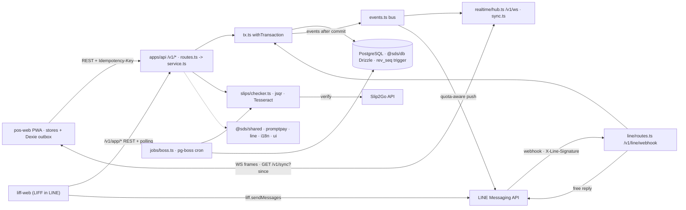

# ARCHITECTURE · code index (as built)
> Verified at `ee9b3b0` (2026-10-17). Drift check: `git diff --stat ee9b3b0..HEAD -- apps packages` -> re-verify the rows of every added, renamed or deleted file; `/checkpoint` refreshes rows and this sha. Planned design: `docs/02-architecture.md` (partly stale) · rules: `CLAUDE.md` · folder layout: D-29 in `docs/decisions.md`.
> Search: a root Glob can time out (`node_modules`, untracked `.claude/skills/**`) -> use `git ls-files <dir>` and `git grep -n <symbol> -- apps packages`. No line numbers here: grep the symbol.
> Notation: §4–5 use repo paths. In §3 a bare `file.ts` is in the row's folder and `dir/file.ts` starts at that workspace's `src/`. `file.ts:fn()` = symbol in that file · `->` = calls / flows to · `{a,b}` = each · `GET|POST` = both.

## 1. Monorepo & runtime topology
- **Workspace:** pnpm 12 (`pnpm-workspace.yaml`: `apps/*`, `packages/*`) + Turbo (`turbo.json`: `build`, `typecheck`, `test`) · Node ≥24 runs `.ts` directly · Biome (`biome.json`) · Vitest everywhere, Playwright in `apps/pos-web/e2e` · `packages/config` = `packages/config/tsconfig.base.json` only.
- **API:** `apps/api` = Fastify + `@fastify/cors`, `@fastify/rate-limit`, `@fastify/websocket`; Zod at every route; `@sentry/node`; esbuild bundle (`apps/api/build.ts`) of `apps/api/src/{server,migrate}.ts` and the CLI entries `apps/api/src/cli/{owner-create,owner-reset,owner-unlock,richmenu-upload}.ts`.
- **Web:** Vite + React. `apps/pos-web` = staff PWA (`vite-plugin-pwa`, `dexie`, `qrcode-generator`). `apps/liff-web` = customer app in LINE (LIFF SDK loaded from LINE's CDN; imports only types from `@sds/shared`, so no Zod in its bundle).
- **Data:** PostgreSQL via `postgres` (postgres.js) + `drizzle-orm`, used only inside `packages/db`; PGlite (`@electric-sql/pglite`) in tests; forward-only SQL in `packages/db/migrations`.
- **Async:** in-process event bus `apps/api/src/events.ts` (published after commit; feeds realtime and LINE pushes); `pg-boss` runs cron jobs only (`apps/api/src/jobs/jobs.ts:JOBS`).
- **External:** LINE Messaging API + webhook (`packages/line`), LIFF ID-token check (`apps/api/src/line/liff-verify.ts`), Slip2Go (`apps/api/src/slips/slip2go.ts`), Tesseract CLI spawned locally (`apps/api/src/slips/ocr.ts`), `jsqr` in a worker thread (`apps/api/src/slips/qr-worker.ts`).

## 2. High-level system & sync flow

## 3. Workspace neural map
### 3A. Shared packages (`packages/*`)
- `@sds/shared` (`packages/shared/src`)
  - **Purpose:** Pure domain core: Zod DTOs, enums, state machines, money.
  - **Key Files & Exports:** `state-machine.ts` (`makeMachine`), `order-machine.ts` (`orderMachine`, `initialOrderStatus`), `payment-machine.ts` (`paymentMachine`, `derivePaymentStatus`), `permissions.ts` (`hasPermission`, `requiresStepUp`, `ROLE_PERMISSIONS`), `money.ts` (`satang`, `sumSatang`, `orderTotals`), `pricing.ts` (`priceOrder`), `cash.ts` (`calculateCashChange`), `gov-copay.ts` (`estimateGovCopaySplit`, `isCopayAvailable`), `payment-adjustment.ts` (`planAdjustment`), `business-date.ts` (`businessDate`), `realtime.ts` (`realtimeFrameSchema`, `syncResponseSchema`, `WS_CLOSE`, `SYNC_SAFETY_REVS`), `slip-verify.ts` (`slip2goVerdict`), `slip-amount.ts` (`extractSlipAmount`, `compareSlipAmount`), `slip-recipient.ts` (`checkSlipRecipient`), `slip-qr.ts` (`parseSlipQr`); Zod/DTO files `orders.ts`, `payments.ts`, `menu.ts`, `settings.ts`, `customer-app.ts`, `auth.ts`, `admin.ts`, `schemas.ts`, `enums.ts`; barrel `index.ts`
  - **Used by:** `apps/api`, `apps/pos-web`, `apps/liff-web` (types only), `packages/db`, `packages/promptpay`
- `@sds/db` (`packages/db/src`)
  - **Purpose:** Drizzle schema, repository functions, migration runner, PGlite.
  - **Key Files & Exports:** `index.ts` (namespaces `authRepo`, `customersRepo`, `invitesRepo`, `lineRepo`, `menuRepo`, `ordersRepo`, `paymentsRepo`, `peopleRepo`, `retentionRepo`, `syncRepo`, `schema`; flat re-exports of `audit.ts`, `client.ts`, `settings.ts`), `client.ts` (`createDb`, `runMigrations`, `pingDb`), `audit.ts` (`insertAudit`), `settings.ts` (`getSettingRow`, `updateSettingRowIfVersion`, `getGovCopayRow`), `sync.ts` (`readChanges`, `currentRev`, `SYNC_POLICY`), `pglite.ts` (`createPgliteDb`; import `@sds/db/pglite`), `seed.ts` (`seed`; import `@sds/db/seed`, not in the barrel), `schema.ts` (barrel over `schema/*.ts`, read by `packages/db/drizzle.config.ts`)
  - **Used by:** `apps/api`
- `@sds/promptpay` (`packages/promptpay/src`)
  - **Purpose:** EMVCo PromptPay payload, TLV codec, CRC16 (pure).
  - **Key Files & Exports:** `payload.ts` (`promptpayPayload`, `crc16`, `tlv`, `decodeTlv`, `hasValidCrc`, `formatAmount`); barrel `index.ts`; bank-app scan page `packages/promptpay/scripts/scan-test.ts`
  - **Used by:** `apps/api` (`apps/api/src/payments/{create,read}.ts`), `apps/pos-web` (`apps/pos-web/src/pos/outbox/offline-promptpay-model.ts` only)
- `@sds/line` (`packages/line/src`)
  - **Purpose:** LINE wire layer: signature, events, router, Flex, sender.
  - **Key Files & Exports:** `signature.ts` (`verifySignature`), `events.ts` (`webhookBodySchema`, `eventUserId`), `router.ts` (`routeEvent`, `KEYWORDS`), `postback.ts` (`encodePostback`, `parsePostback`), `flex.ts` (`orderConfirmation`, `paymentInstructions`, `methodPicker`, `orderStatusCard`, `readyCard`, `receiptCard`, `followGreeting`, `botText`), `sender.ts` (`createLineSender`: `reply`, `push`), `client.ts` (`createLineClient`), `policy.ts` (`parseLinePolicy`, `quotaMonth`, `thresholdsReached`), `order-text.ts` (`orderPlacedText`, `parseOrderPlacedText`), `richmenu.ts` (`loadRichMenu`, `DEFAULT_RICH_MENU`), `richmenu-upload.ts` (`uploadRichMenu`)
  - **Used by:** `apps/api` (`apps/api/src/line/`, `apps/api/src/cli/richmenu-upload.ts`), `apps/liff-web` (`@sds/line/order-text` only)
- `@sds/i18n` (`packages/i18n/src`)
  - **Purpose:** th/en catalogs, translator, baht and Buddhist-Era formatters.
  - **Key Files & Exports:** `translate.ts` (`t`, `translator`, `LOCALES`, `DEFAULT_LOCALE`), `th.ts` (`th`, `MessageKey`; barrel over `th/*.ts`), `en.ts` (`en`; barrel over `en/*.ts`), `format.ts` (`formatBaht`, `formatDate`, `DISPLAY_TIME_ZONE`), `receipt.ts` (`receiptHtml`, `receiptFileName`); a new catalog part must be added to `catalog-parts.test.ts`
  - **Used by:** `apps/pos-web`, `apps/liff-web`, `packages/line`
- `@sds/ui` (`packages/ui/src`)
  - **Purpose:** Design tokens, theme resolver, CSS variables, contrast checks.
  - **Key Files & Exports:** `tokens.ts` (`baseTokens`, `darkOverrides`, `deviceDefaults`, `DEVICES`), `resolve.ts` (`resolveTokens`), `css.ts` (`toCssVariables`, `CSS_VAR_PREFIX`), `contrast.ts` (`contrastRatio`), `brand.ts` (`defaultBrand`); CSS `tokens.css`, `glass.css`, `design.css`; generator `packages/ui/scripts/generate-tokens-css.ts`
  - **Used by:** `apps/pos-web` (`apps/pos-web/src/main.tsx`, `apps/pos-web/src/theme/`), `apps/liff-web`

### 3B. Backend vertical slices (`apps/api/src/*`)
- `Auth + admin` (`apps/api/src/{auth,admin}`)
  - **Purpose:** Device tokens, PIN/owner sign-in, sessions, step-up, staff/device admin.
  - **Routes/Entry:** `auth/routes.ts` (`POST /v1/auth/{device,pin,owner,step-up,logout,invite/preview,invite/accept}`, `GET /v1/auth/{staff,me}`), `admin/routes.ts` (`GET /v1/devices`, `POST /v1/devices/:id/{revoke,outbox-recovery}`, `GET|POST /v1/staff`, `PATCH /v1/staff/:id`, `POST /v1/staff/:id/{role,pin}`, `GET|POST /v1/staff/invites`, `POST /v1/staff/invites/:id/revoke`) -> **Logic:** `auth/devices.ts:registerDevice()`, `auth/pin.ts:pinLogin()`, `auth/owner-login.ts:ownerLogin()`, `auth/sessions.ts:issueSession()`, `auth/step-up.ts:stepUp()`, `auth/invite-accept.ts:acceptInvite()`, `auth/guards.ts:createGuard()`, `admin/service.ts:createStaffMember()`, `admin/invites.ts:createInvite()` -> **DB Tables:** `staff`, `owner_credentials`, `devices`, `sessions`, `staff_invites`, `audit_log`
  - **Depends on:** `@sds/shared` (`permissions.ts`, `auth.ts`, `admin.ts`), `@sds/db` (`authRepo`, `peopleRepo`, `invitesRepo`, `insertAudit`), `auth/crypto.ts` (`hashPin`, `verifyPassword`, `newToken`), `auth/totp.ts:verifyTotp()`, `auth/policy.ts:DEFAULT_AUTH_POLICY`; import surface `auth/service.ts`
- `Orders` (`apps/api/src/orders`)
  - **Purpose:** Create, list, move, correct, void and receipt orders.
  - **Routes/Entry:** `routes.ts` (`POST|GET /v1/orders`, `GET /v1/orders/summary`, `GET|PATCH /v1/orders/:id`, `POST /v1/orders/:id/{transition,cancel,receipt,void}`, `PATCH /v1/orders/:id/correction`), `recipients.ts` (`GET /v1/recipients`) -> **Logic:** `service.ts:createOrder()`, `transitionOrder()`, `patchOrder()`, `listOrdersForDay()`, `summarizeOrdersForMonth()`, `correction.ts:correctOrder()`, `voidOrder()`, `receipt.ts:issueReceipt()`, `dto.ts:toOrderDto()` -> **DB Tables:** `orders`, `order_items`, `daily_counters`, `payments`, `customers`, `settings`, `audit_log`
  - **Depends on:** `@sds/shared` (`order-machine.ts`, `pricing.ts`, `business-date.ts`), `@sds/db` (`ordersRepo`, `customersRepo`, `insertAudit`), `payments/service.ts` (`settlePaymentsForOrderCancel`), `line/order-change-push.ts:notifyOrderChange()` (callback wired in `v1.ts`), `request-hash.ts:orderRequestHash()`, `business-day.ts:currentBusinessDate()`
- `Payments` (`apps/api/src/payments`)
  - **Purpose:** Create, claim, confirm, change method, void, refund; PromptPay QR.
  - **Routes/Entry:** `routes.ts` (`POST|GET /v1/orders/:id/payments`, `POST /v1/payments/:id/{claim,confirm,cancel-claimed,change-method,void,refund,slip-recheck,slip-block/clear}`, `GET /v1/payments/:id/{slip,qr-url,qr.png}` (`qr.png?...&download=1` adds `Content-Disposition: attachment`, outside the signed proof)) -> **Logic:** `create.ts:createPayment()`, `moves.ts:movePayment()`, `change-method.ts:changePaymentMethod()`, `auto-confirm.ts:autoConfirmClaimedPayment()`, `read.ts:paymentQrUrl()`, `renderPaymentQr()`, `order-hooks.ts:settlePaymentsForOrderCancel()`, `internal.ts:settleOrder()`, `emitPayment()`; the slip routes call `slips/service.ts` -> **DB Tables:** `payments`, `payment_refunds`, `orders`, `gov_copay_schemes`, `settings`, `audit_log`
  - **Depends on:** `@sds/shared` (`payment-machine.ts`, `cash.ts`, `gov-copay.ts`, `payment-adjustment.ts`), `@sds/promptpay` (`promptpayPayload`), `@sds/db` (`paymentsRepo`, `ordersRepo`), `qr.ts` (`signQrLink`, `qrPng`), `request-hash.ts:paymentRequestHash()`, `line/payment-rejected-push.ts:notifyPaymentRejected()`; import surface `service.ts`
- `Slips` (`apps/api/src/slips`)
  - **Purpose:** Slip files, QR/OCR reading, Slip2Go check queue.
  - **Routes/Entry:** no routes of its own: `service.ts:attachSlip()` (from `customer-app/routes.ts`, `line/handlers.ts`), `recheckSlip()`, `clearSlipBlock()`, `readSlip()` (from `payments/routes.ts`); installed by `server.ts` via `checker.ts:installSlipChecker()`, `slip2go.ts:installSlipVerifier()` -> **Logic:** `checker.ts:createSlipChecker()` (`enqueue`, `sweep`, `recheck`, `evaluate`, `readOcr`, `readVerify`), `slip2go.ts:createSlip2goVerifier()` (`verifyQr`, `verifyImage`), `qr.ts:createWorkerQrReader()` (`readRaw`) -> `qr-worker.ts` -> `qr-decode.ts:readSlipQrText()`, `ocr.ts:createTesseractOcr()`, `guard.ts:slipUploadRefusal()`, `store.ts:createFsSlipStore()` -> **DB Tables:** `payments`, `slip_verify_daily`, `orders`, `customers`, `audit_log`
  - **Depends on:** `@sds/shared` (`slip-verify.ts`, `slip-amount.ts`, `slip-recipient.ts`, `slip-ref.ts`, `slip-qr.ts`), `payments/service.ts:autoConfirmClaimedPayment()`, Slip2Go API, `jsqr` + `jpeg-js` + `pngjs`, Tesseract CLI; env `SLIP_VERIFIER`, `SLIP_OCR`, `SLIP_QR`, `SLIP_AUTOCONFIRM` (`config.ts`)
- `Customer app` (`apps/api/src/customer-app`)
  - **Purpose:** LIFF customer API: session, checkout, orders, payment, slip.
  - **Routes/Entry:** `routes.ts` (`POST /v1/app/session`, `GET /v1/app/checkout`, `GET|PUT /v1/app/member`, `POST /v1/app/privacy-ack`, `POST|GET /v1/app/orders`, `GET /v1/app/orders/:id`, `POST /v1/app/orders/:id/{payment,claim,slip}`, `GET /v1/app/orders/:id/{slip,qr}`) -> **Logic:** `service.ts:openSession()`, `placeOrder()`, `selectPayment()`, `claimPayment()`, `myQr()`, `viewOrder()`, `checkoutInfo()`, `session.ts:createCustomerGuard()`, `signCustomerToken()` -> **DB Tables:** `customers`, `orders`, `order_items`, `payments`
  - **Depends on:** `line/liff-verify.ts:createLiffVerifier()` (LIFF token -> LINE), `orders/service.ts:createOrder()`, `payments/service.ts` (`createPayment`, `movePayment`, `changePaymentMethod`), `slips/service.ts:attachSlip()`, `slips/guard.ts`, `@sds/shared` (`customer-app.ts`)
- `Customers` (`apps/api/src/customers`)
  - **Purpose:** Staff-side slip flag and PDPA anonymize per customer.
  - **Routes/Entry:** `routes.ts` (`GET /v1/customers/:id/slip-flag`, `POST /v1/customers/:id/{slip-flag/clear,anonymize}`) -> **Logic:** `service.ts:getSlipFlag()`, `clearSlipFlag()`, `anonymizeCustomer()` -> **DB Tables:** `customers`, `orders`, `payments`, `audit_log`
  - **Depends on:** `@sds/db` (`customersRepo`, `ordersRepo`, `insertAudit`), `slips/store.ts` (slip files), `@sds/shared` (`customers.ts`)
- `Menu` (`apps/api/src/menu`)
  - **Purpose:** Public menu, staff CRUD, availability, photos, sort order.
  - **Routes/Entry:** `routes.ts` (`GET /v1/menu`, `GET /v1/menu/costs`, `POST /v1/menu/reorder`, `GET|POST /v1/menu/{categories,items,modifier-groups}`, `GET /v1/menu/items/:id`, `PATCH|DELETE /v1/menu/{categories,items,modifier-groups,modifier-options}/:id`, `PUT|GET|DELETE /v1/menu/items/:id/photo`, `PATCH /v1/menu/{items,modifier-options}/:id/availability`, `POST /v1/menu/modifier-groups/:groupId/options`) -> **Logic:** `reads.ts:publicMenu()`, `listItems()`, `listCosts()`, `items.ts:createItem()`, `patchItem()`, `setItemAvailability()`, `categories.ts:createCategory()`, `groups.ts:createGroup()`, `createOption()`, `photos.ts:setItemPhoto()`, `reorder.ts:reorder()`, `internal.ts:publish()` -> **DB Tables:** `menu_categories`, `menu_items`, `menu_item_photos`, `menu_item_channel_prices`, `modifier_groups`, `modifier_options`, `menu_item_modifier_groups`, `audit_log`
  - **Depends on:** `@sds/db` (`menuRepo`, `syncRepo`, `insertAudit`), `@sds/shared` (`menu.ts`, `image.ts`), `request-hash.ts:menuRequestHash()`, `dto.ts:itemDto()`; import surface `service.ts` (also used by `realtime/frames.ts`)
- `Settings` (`apps/api/src/settings`)
  - **Purpose:** Versioned shop settings resources and the co-pay scheme.
  - **Routes/Entry:** `routes.ts` (`GET|PATCH /v1/settings/{shop,opening-hours,line-ordering,numbering,payments,delivery,promptpay,receipt,bank-account,gov-copay}`, `PUT /v1/settings/delivery`) -> **Logic:** `service.ts:RESOURCES`, `readSetting()`, `patchSetting()`, `readGovCopay()`, `patchGovCopay()`, `currentPromptpayId()`, `currentOpeningHours()`, `lineOrderingNow()` -> **DB Tables:** `settings`, `gov_copay_schemes`, `audit_log`
  - **Depends on:** `@sds/db` (`getSettingRow`, `updateSettingRowIfVersion`, `getGovCopayRow`, `updateGovCopayRowIfVersion`), `@sds/shared` (`settings.ts`), `auth/service.ts` (`securityAlert`)
- `LINE` (`apps/api/src/line`)
  - **Purpose:** Webhook intake, chat handlers, LIFF token check, quota pushes.
  - **Routes/Entry:** `routes.ts` (`POST /v1/line/webhook`, `GET /v1/line/quota`), bus subscriber `completion-push.ts:registerCompletionPush()`, job `retry.ts:retryLineEvents()` -> **Logic:** `handlers.ts:handleEvent()`, `handleOrderPlaced()`, `handleSlip()`, `runtime.ts:createLineRuntime()`, `buildSender()`, `dbQuotaStore()`, `stored-route.ts:toStoredRoute()`, `order-change-push.ts:notifyOrderChange()`, `payment-rejected-push.ts:notifyPaymentRejected()`, `liff-verify.ts:createLiffVerifier()`, `liff-health.ts:createLiffHealth()`, `receipt.ts:receiptItems()` -> **DB Tables:** `line_events`, `line_button_replies`, `line_message_log`, `line_quota_months`, `customers`, `orders`, `payments`
  - **Depends on:** `@sds/line`, `@sds/db` (`lineRepo`, `ordersRepo`, `paymentsRepo`), `customer-app/service.ts` (`viewOrder`, `selectPayment`, `claimPayment`), `slips/service.ts:attachSlip()`, `settings/service.ts` (`currentPromptpayId`), LINE Messaging API
- `Realtime` (`apps/api/src/realtime`)
  - **Purpose:** WebSocket fan-out of bus events; rev-paged catch-up.
  - **Routes/Entry:** `routes.ts:setupRealtime()`, `registerRealtimeRoutes()` (`GET /v1/ws` upgrade, `GET /v1/sync`) -> **Logic:** `hub.ts:createHub()` (`accept`, `authenticate`, `onEvent`), `frames.ts:frameFromEvent()`, `mayReceive()`, `frameForRole()`, `frameFromEntry()`, `sync.ts:createCatchUp()` -> **DB Tables:** every `SYNCED_TABLES` table via `syncRepo` (read only)
  - **Depends on:** `events.ts` (bus), `auth/service.ts:peekSession()`, `@sds/shared` (`realtime.ts`), `@fastify/websocket`, `menu/service.ts` (DTO mappers); tests use `test-helpers.ts`
- `Jobs` (`apps/api/src/jobs`)
  - **Purpose:** pg-boss cron: retention, LINE retry, slip sweep, Slip2Go check.
  - **Routes/Entry:** `boss.ts:startJobs()`, started by `server.ts` through `supervisor.ts:superviseJobs()` -> **Logic:** `jobs.ts:JOBS` (`line-events-retry`, `slip-check-sweep`, `slip2go-account-check`, `retention-*`), `retention.ts:anonymizeOrders()`, `purgeSlips()`, `sweepOrphanSlips()`, `slip2go.ts:checkSlip2goAccount()` -> **DB Tables:** `orders`, `payments`, `customers`, `devices`, `staff_invites`, `line_events`, `line_button_replies` (+ pg-boss's own schema)
  - **Depends on:** `pg-boss`, `@sds/db` (`retentionRepo`), `line/retry.ts:retryLineEvents()`, `slips/checker.ts:activeSlipChecker()`, `slips/slip2go.ts:activeSlipVerifier()`, `alerts.ts`

### 3C. Frontend modules (`apps/pos-web/src/*`, `apps/liff-web/src/*`)
- `pos-web shell` (`apps/pos-web/src`)
  - **Purpose:** Boot, auth gate, role-filtered hash routes, nav shell.
  - **UI Entry:** `main.tsx` -> `App.tsx` -> `ui/Shell.tsx` -> **State/Store/Hook:** `services.ts:createServices()`, `app/routes.ts` (`ROUTES`, `allowedRoutes`, `resolveRoute`), `ui/hooks.ts` (`useServices`, `useAuthState`) -> **I/O (API/WS/Dexie/Platform):** `platform/serviceWorker.ts`, `platform/appUpdates.ts:createAppUpdates()`, `dev/enable.ts:devBackend()` (mock backend in dev)
- `pos-web auth` (`apps/pos-web/src/{auth,ui}`)
  - **Purpose:** Device registration, PIN and owner sign-in, step-up.
  - **UI Entry:** `RegisterDeviceScreen.tsx`, `PinScreen.tsx` (`PinPad.tsx`), `OwnerSignInScreen.tsx`, `StepUpDialog.tsx` -> **State/Store/Hook:** `auth-store.ts:createAuthStore()` (`registerDevice`, `signInWithPin`, `signInOwner`, `ensureStepUp`, `submitStepUp`, `runSensitive`, `signOut`), `pin-pad.ts`, `owner-form.ts` -> **I/O (API/WS/Dexie/Platform):** `api/resources/auth.ts:makeAuth()`, `platform/tokenStore.ts:createWebTokenStore()`, `lib/keepalive.ts:startSessionKeepalive()`
- `pos-web realtime` (`apps/pos-web/src/realtime`)
  - **Purpose:** WebSocket connection, rev catch-up, client entity store.
  - **UI Entry:** `ui/SyncPill.tsx` (`SyncPill`), `ui/hooks.ts` (`useEntities`, `useConnection`) -> **State/Store/Hook:** `entity-store.ts:createEntityStore()` (`apply`, `applyMany`, `hydrate`, `advance`, `reset`), `selectors.ts:groupsWithOptions()`, `bind.ts:bindRealtime()` -> **I/O (API/WS/Dexie/Platform):** `connection.ts:createConnection()` (`connect`, `catchUp`, `onMessage`, `onFrame`), `platform/socket.ts:createWebSocket()`, `api/resources/sync.ts:makeSync()`, `platform/lifecycle.ts:webLifecycle`
- `pos/cart` (`apps/pos-web/src/pos/cart`)
  - **Purpose:** Storefront and platform order entry, modifiers, delivery recipient.
  - **UI Entry:** `OrderEntryScreen.tsx` (`CartPanel.tsx`, `ModifierSheet.tsx`, `DeliveryFields.tsx`, `PlatformFields.tsx`) -> **State/Store/Hook:** `cart-store.ts:createCartStore()` (`submit`, `mayHaveBeenCreated`), `cart-pricing.ts:priceCart()`, `menu-model.ts:buildMenu()`, `selection.ts`, `recipient-store.ts:createRecipientStore()`, `use-cart.ts:useCart()` -> **I/O (API/WS/Dexie/Platform):** `api/resources/orders.ts:makeOrders()` (`create`), `api/resources/recipients.ts:makeRecipients()`, `pos/outbox/outbox-store.ts` (`enqueueOrder`), `catalogue-cache.ts:createCatalogueCache()`
- `pos/orders` (`apps/pos-web/src/pos/orders`)
  - **Purpose:** Day board, order detail, status moves, month view, dashboard.
  - **UI Entry:** `OrdersScreen.tsx` (`OrdersTable.tsx`, `OrdersPhone.tsx`, `DetailPanel.tsx`, `DayPicker.tsx`), `OrderDetailScreen.tsx`, `MonthOverview.tsx`, `DashboardScreen.tsx` (sample data from `dashboard-sample.ts`) -> **State/Store/Hook:** `order-board.ts` (`ordersForDay`, `filterOrders`, `boardColumns`, `orderMoves`), `order-moves-store.ts:createOrderMovesStore()` (`transition`, `cancel`), `month-model.ts`, `use-load-orders.ts:useLoadOrders()` -> **I/O (API/WS/Dexie/Platform):** `api/resources/orders.ts` (`list`, `summary`, `get`, `transition`, `cancel`), realtime entities
- `pos/kitchen` (`apps/pos-web/src/pos/kitchen`)
  - **Purpose:** Kitchen queue, ticket timers, new-order sound alarm.
  - **UI Entry:** `KitchenScreen.tsx` (`KitchenTicket.tsx`, `SoundControl.tsx`) -> **State/Store/Hook:** `kitchen-model.ts` (`kitchenQueue`, `waitLevel`, `kitchenMoves`), `new-order-alarm.ts:createNewOrderAlarm()`, `use-kitchen-display.ts:useKitchenDisplay()` -> **I/O (API/WS/Dexie/Platform):** `pos/orders/order-moves-store.ts`, `platform/sound.ts:createSound()`, `platform/webAudio.ts`, `platform/wakeLock.ts:createWebWakeLock()`
- `pos/payments + pos/slips` (`apps/pos-web/src/pos/{payments,slips}`)
  - **Purpose:** Cash, PromptPay, co-pay; method change, void/refund; slip review.
  - **UI Entry:** `PaymentPanel.tsx` (`MethodTiles.tsx`, `CashPanel.tsx`, `PromptPayPanel.tsx`, `PromptPayQr.tsx`, `GovCopayPanel.tsx`, `ChangeMethod.tsx`, `VoidRefundDialog.tsx`, `ReceiptActions.tsx`), `SlipView.tsx`, `SlipAlerts.tsx` -> **State/Store/Hook:** `payment-store.ts:createPaymentStore()` (`create`, `claim`, `confirm`, `changeMethod`, `voidPayment`, `refundPayment`), `payment-model.ts`, `slip-gate.ts`, `promptpay-cache.ts:createPromptpayCache()`, `use-ledger.ts` -> **I/O (API/WS/Dexie/Platform):** `api/resources/payments.ts:makePayments()` (`qrUrl`, `slip`, `slipRecheck`, `slipBlockClear`)
- `pos/outbox` (`apps/pos-web/src/pos/outbox`)
  - **Purpose:** Offline queue of orders and payments, replay, offline QR.
  - **UI Entry:** `QueuedOrders.tsx`, `LocalOrderScreen.tsx`, `OfflinePromptPay.tsx`, `QueueActions.tsx`, `SignOutGuard.tsx`, `ui/SyncPill.tsx` (`OutboxPill`) -> **State/Store/Hook:** `outbox-store.ts:createOutboxStore()` (`enqueueOrder`, `enqueueCash`, `enqueuePromptpay`, `retry`, `discard`, `kick`), `outbox-model.ts`, `offline-promptpay-model.ts:offlineQr()` -> **I/O (API/WS/Dexie/Platform):** `platform/localStore.ts:openLocalStore()` -> `platform/dexieStore.ts` (tables `kv`, `outbox`), `api/resources/{orders,payments}.ts`, `@sds/promptpay`
- `pos/correction` (`apps/pos-web/src/pos/correction`)
  - **Purpose:** Past-order line corrections and voids with refunds.
  - **UI Entry:** `OrderCorrection.tsx` (`OrderCorrectionActions`) -> **State/Store/Hook:** `correction-model.ts` (`draftFromOrder`, `buildCorrection`, `canCorrectOrder`) -> **I/O (API/WS/Dexie/Platform):** `api/resources/orders.ts` (`correct`, `void`)
- `menu-editor` (`apps/pos-web/src/menu-editor`)
  - **Purpose:** Categories, items, modifier groups, photos, sold-out switches.
  - **UI Entry:** `MenuEditorScreen.tsx` (`ItemsTab.tsx`, `CategoriesTab.tsx`, `GroupsTab.tsx`, `ItemDialog.tsx`, `PhotoField.tsx`) -> **State/Store/Hook:** `menu-editor-store.ts:createMenuEditorStore()`, `model.ts` (`validateItemForm`, `buildItemCreate`, `buildItemPatch`), `photo-plan.ts:preparePhoto()`, `use-saver.ts:useSaver()` -> **I/O (API/WS/Dexie/Platform):** `api/resources/menu.ts:makeMenu()`, `platform/photo.ts:createWebPhotoEngine()`
- `settings` (`apps/pos-web/src/settings`)
  - **Purpose:** Settings hub and forms, PromptPay change, staff, invites, devices.
  - **UI Entry:** `SettingsHub.tsx`, `SettingsSectionScreen.tsx` (`ShopForm.tsx`, `HoursForm.tsx`, `PromptpayForm.tsx`, `CopayForm.tsx`, `DeliveryForm.tsx`), `StaffScreen.tsx`, `DevicesScreen.tsx` -> **State/Store/Hook:** `settings-store.ts:createSettingsStore()`, `admin-store.ts:createAdminStore()`, `sections.ts:SECTIONS`, `model.ts`, `promptpay-model.ts`, `copay-model.ts`, `staff-model.ts` -> **I/O (API/WS/Dexie/Platform):** `api/resources/{settings,admin,devices}.ts`
- `invite` (`apps/pos-web/src/invite`)
  - **Purpose:** Accept a staff invite link: password, TOTP, PIN.
  - **UI Entry:** `InviteApp.tsx` -> `InvitePage.tsx` -> **State/Store/Hook:** `invite-store.ts:createInviteStore()` (`start`, `accept`), `invite-model.ts:buildAccept()` -> **I/O (API/WS/Dexie/Platform):** `api/resources/auth.ts` (`invitePreview`, `inviteAccept`), `platform/appLocation.ts:takeInviteToken()`
- `liff-web shell` (`apps/liff-web/src`)
  - **Purpose:** LIFF boot, customer session, path routing, locale.
  - **UI Entry:** `main.tsx` -> `App.tsx` -> **State/Store/Hook:** `ui/app-context.tsx` (`useApp`, `useT`, `errorText`) -> **I/O (API/WS/Dexie/Platform):** `platform/liff.ts:startPlatform()` (LIFF SDK from CDN), `api/client.ts:createApi()` (`POST /v1/app/session`), `platform/config.ts:apiUrl()`
- `liff menu, cart, member` (`apps/liff-web/src/{ui,model}`)
  - **Purpose:** Menu browsing, cart, checkout form, member profile, privacy.
  - **UI Entry:** `MenuScreen.tsx`, `CartScreen.tsx` (`CheckoutScreen`, `PrivacyGate`), `MemberScreen.tsx` -> **State/Store/Hook:** `cart.ts` (`addLine`, `estimateTotal`, `toOrderItems`), `checkout.ts` (`formProblems`, `createRequestIds`), `member.ts` (`memberInput`) -> **I/O (API/WS/Dexie/Platform):** `api/client.ts` (`menu`, `checkout`, `placeOrder`, `saveMember`, `acknowledgePrivacy`), `platform/liff.ts` (`sendText`)
- `liff order & pay` (`apps/liff-web/src/ui/order`)
  - **Purpose:** Order status, pay method, PromptPay QR, slip upload.
  - **UI Entry:** `screens.tsx` (`OrderScreen`, `OrdersScreen`) -> `OrderView.tsx` (`PromptPayPanel.tsx`, `QrViewer.tsx`, `SentSlip.tsx`, `popups.tsx`) -> **State/Store/Hook:** `use-order.ts:useOrder()`, `status-maps.ts`, `model/steps.ts:orderSteps()`, `model/slip-progress.ts`, `model/paid-popup.ts` -> **I/O (API/WS/Dexie/Platform):** `api/client.ts` (`order`, `selectPayment`, `claim`, `attachSlip`, `qr`), `model/poll.ts:nextPollDelayMs()` (polling, no socket), `model/qr-save.ts:saveQrImage()` / `browserSaveEnv()` (share sheet, then a blob download outside LINE; inside LINE it follows the `download=1` file link and the large QR shows the https picture)

## 4. Critical cross-cutting execution traces
1. **Order creation & state transition:** POS `apps/pos-web/src/pos/cart/cart-store.ts:submit()` -> `apps/pos-web/src/api/resources/orders.ts:makeOrders()` `create` (`POST /v1/orders` + `Idempotency-Key`; offline or unsure -> `apps/pos-web/src/pos/outbox/outbox-store.ts:enqueueOrder()`) · LIFF `apps/liff-web/src/ui/CartScreen.tsx:CheckoutScreen` -> `apps/liff-web/src/api/client.ts:createApi()` `placeOrder` (`POST /v1/app/orders`) -> `apps/api/src/customer-app/service.ts:placeOrder()`
   - Create: `apps/api/src/orders/routes.ts:registerOrderRoutes()` -> `apps/api/src/orders/service.ts:createOrder()` (`orderRequestHash()` + `findOrderByClientRequestId()` = replay) -> `apps/api/src/tx.ts:withTransaction()` -> `packages/shared/src/pricing.ts:priceOrder()` -> `packages/db/src/orders.ts:nextDailySeq()`, `insertOrder()`, `insertOrderItems()` + `packages/db/src/audit.ts:insertAudit()` -> trigger `packages/db/migrations/0000_functions.sql:set_sync_columns()` -> `emitUpserted()` (`order.upserted`) + `alert.new_order`
   - Transition: `POST /v1/orders/:id/transition` -> `apps/api/src/orders/service.ts:transitionOrder()` -> `packages/shared/src/order-machine.ts:orderMachine` (`packages/shared/src/state-machine.ts:makeMachine()`) -> `packages/db/src/orders.ts:updateOrderIfVersion()`; a cancel also runs `apps/api/src/payments/order-hooks.ts:settlePaymentsForOrderCancel()`
   - Fan-out after commit: `apps/api/src/events.ts:createEventBus()` `publish` -> `apps/api/src/realtime/hub.ts:createHub()` `onEvent` -> `apps/api/src/realtime/frames.ts:frameFromEvent()`, `mayReceive()`, `frameForRole()` -> socket -> `apps/pos-web/src/realtime/connection.ts:onFrame()` -> `apps/pos-web/src/realtime/entity-store.ts:apply()`; LINE: `apps/api/src/line/completion-push.ts:registerCompletionPush()`
2. **Payment & slip verification:** `apps/pos-web/src/pos/payments/payment-store.ts:createPaymentStore()` `create` -> `apps/pos-web/src/api/resources/payments.ts:makePayments()` (`POST /v1/orders/:id/payments`) -> `apps/api/src/payments/create.ts:createPayment()` -> `packages/promptpay/src/payload.ts:promptpayPayload()` (fail fast) or cash `packages/shared/src/payment-machine.ts:paymentMachine` -> `apps/api/src/payments/internal.ts:settleOrder()`, `emitPayment()`
   - QR: `apps/pos-web/src/pos/payments/PromptPayQr.tsx` -> `GET /v1/payments/:id/qr-url` -> `apps/api/src/payments/read.ts:paymentQrUrl()` (`apps/api/src/payments/qr.ts:signQrLink()`) -> `GET /v1/payments/:id/qr.png` (customer app: `&download=1` for the save button inside LINE) -> `renderPaymentQr()` -> `promptpayPayload()` -> `qrPng()` · offline `apps/pos-web/src/pos/outbox/offline-promptpay-model.ts:offlineQr()` · LIFF `GET /v1/app/orders/:id/qr` -> `apps/api/src/customer-app/service.ts:myQr()`
   - Slip: `POST /v1/app/orders/:id/slip` or a LINE image `apps/api/src/line/handlers.ts:handleSlip()` -> `apps/api/src/slips/service.ts:attachSlip()` -> `apps/api/src/slips/checker.ts:createSlipChecker()` `enqueue` -> `read()` -> `evaluate()` (QR `apps/api/src/slips/qr.ts:createWorkerQrReader()` -> `apps/api/src/slips/qr-worker.ts` -> `apps/api/src/slips/qr-decode.ts:readSlipQrText()`; OCR `readOcr()` -> `apps/api/src/slips/ocr.ts:createTesseractOcr()` -> `packages/shared/src/slip-amount.ts:compareSlipAmount()`) -> `readVerify()` -> `apps/api/src/slips/slip2go.ts:createSlip2goVerifier()` -> `packages/shared/src/slip-verify.ts:slip2goVerdict()`; missed reads retried by job `slip-check-sweep`
   - Confirm: `200200` + `autoConfirm` -> `apps/api/src/payments/auto-confirm.ts:autoConfirmClaimedPayment()` (actor `system`) · staff `POST /v1/payments/:id/{claim,confirm,void,refund}` -> `apps/api/src/payments/moves.ts:movePayment()` -> `packages/shared/src/payment-machine.ts:paymentMachine` + `derivePaymentStatus()`
3. **Realtime sync & offline outbox replay:** `apps/pos-web/src/services.ts:createServices()` -> `apps/pos-web/src/realtime/bind.ts:bindRealtime()` (signed in: `start`) -> `apps/pos-web/src/realtime/connection.ts:connect()` -> `apps/pos-web/src/platform/socket.ts:createWebSocket()` -> `GET /v1/ws` -> `apps/api/src/realtime/hub.ts:createHub()` `accept` -> `authenticate()` (first message) -> `ready` + `serverRev`
   - Catch-up: `apps/pos-web/src/realtime/connection.ts:catchUp()` (calls `fetchSync` from `lastRev - SYNC_SAFETY_REVS`, follows `nextSince`) -> `apps/pos-web/src/api/resources/sync.ts:makeSync()` `changes` (`GET /v1/sync`) -> `apps/api/src/realtime/sync.ts:createCatchUp()` -> `packages/db/src/sync.ts:readChanges()` -> `apps/api/src/realtime/frames.ts:frameFromEntry()` -> `apps/pos-web/src/realtime/entity-store.ts:applyMany()`, `advance()`; `serverRev` below `lastRev` -> `reset()` (restored DB)
   - Read: `apps/pos-web/src/ui/hooks.ts:useEntities()` + `apps/pos-web/src/realtime/selectors.ts:groupsWithOptions()` + feature models `apps/pos-web/src/pos/orders/order-board.ts:boardColumns()`, `apps/pos-web/src/pos/kitchen/kitchen-model.ts:kitchenQueue()`
   - Outbox: `apps/pos-web/src/pos/outbox/outbox-store.ts:enqueueOrder()` (`enqueueCash`, `enqueuePromptpay`) -> `apps/pos-web/src/platform/localStore.ts:openLocalStore()` -> `apps/pos-web/src/platform/dexieStore.ts:createDexieLocalStore()` (table `outbox`) · replay: `follow()` (connection or lifecycle `online`) -> `kick()` -> `pump()` -> `replay()` -> `send()` (stored body + `clientRequestId`) -> `orderSynced()` / `paymentSynced()`
4. **LINE OA webhook & notifications:** `POST /v1/line/webhook` -> `apps/api/src/line/routes.ts:registerLineRoutes()` (raw body; `apps/api/src/auth/guards.ts:markLineSignatureCheck()` -> `packages/line/src/signature.ts:verifySignature()`) -> `packages/line/src/events.ts:webhookBodySchema` -> `packages/line/src/router.ts:routeEvent()` -> `apps/api/src/line/stored-route.ts:toStoredRoute()` -> `packages/db/src/line.ts:insertEventIfNew()` (dedupe) -> HTTP 200
   - Handle after the 200: `apps/api/src/line/handlers.ts:handleEvent()` -> `say()` -> `packages/line/src/sender.ts:createLineSender()` `reply` (free) + `packages/line/src/flex.ts` (`orderConfirmation`, `paymentInstructions`, `methodPicker`, `orderStatusCard`) -> `packages/line/src/client.ts:createLineClient()`
   - Reply-first: `apps/liff-web/src/ui/CartScreen.tsx` -> `packages/line/src/order-text.ts:orderPlacedText()` -> `apps/liff-web/src/platform/liff.ts:startPlatform()` `sendText` (`liff.sendMessages`) -> webhook `order_placed` (`parseOrderPlacedText()`) -> `apps/api/src/line/handlers.ts:handleOrderPlaced()`
   - Push: `apps/api/src/line/completion-push.ts:sendReady()` (`readyCard`), `apps/api/src/line/order-change-push.ts:notifyOrderChange()`, `apps/api/src/line/payment-rejected-push.ts:notifyPaymentRejected()` -> `apps/api/src/line/runtime.ts:buildSender()` -> `dbQuotaStore()` -> `packages/db/src/line.ts:reservePush()` + `packages/line/src/policy.ts:thresholdsReached()` -> `push`; retry job `line-events-retry` -> `apps/api/src/line/retry.ts:retryLineEvents()` -> `fromStoredRoute()` -> `handleEvent()`
5. **Auth, device token & step-up RBAC:** `apps/pos-web/src/ui/RegisterDeviceScreen.tsx` -> `apps/pos-web/src/auth/auth-store.ts:createAuthStore()` `registerDevice` -> `POST /v1/auth/device` -> `apps/api/src/auth/devices.ts:registerDevice()` (`apps/api/src/auth/crypto.ts:newToken()`, `hashToken()`, `packages/db/src/auth.ts:insertDevice()`) -> token kept by `apps/pos-web/src/platform/tokenStore.ts:createWebTokenStore()`
   - Sign-in: `apps/pos-web/src/ui/PinScreen.tsx` -> `signInWithPin` -> `POST /v1/auth/pin` -> `apps/api/src/auth/pin.ts:pinLogin()` -> `attemptPin()` -> `verifyPin()` -> `apps/api/src/auth/sessions.ts:issueSession()` · owner `signInOwner` -> `POST /v1/auth/owner` -> `apps/api/src/auth/owner-login.ts:ownerLogin()` -> `verifyPassword()` + `apps/api/src/auth/totp.ts:verifyTotp()` + `claimTotpStep()`
   - Guard: `onRequest: guard('<permission>')` -> `apps/api/src/auth/guards.ts:createGuard()` -> `apps/api/src/auth/sessions.ts:authenticateSession()` -> `packages/shared/src/permissions.ts:hasPermission()`, `requiresStepUp()` -> `apps/api/src/auth/context.ts:hasFreshStepUp()` -> `apps/api/src/errors.ts:stepUpRequired()`
   - Step-up: `apps/pos-web/src/ui/StepUpDialog.tsx` -> `submitStepUp` (`stepUpMethodFor()`) -> `POST /v1/auth/step-up` -> `apps/api/src/auth/step-up.ts:stepUp()` -> `packages/db/src/auth.ts:setSessionStepUp()` + `packages/db/src/audit.ts:insertAudit()` (`audit_log`) + `apps/api/src/auth/context.ts:securityAlert()`

## 5. Database schema & global utilities quick-index
**Drizzle schema map** (`packages/db/src/schema`; no `pgEnum`: value lists are `@sds/shared` const arrays, mostly `packages/shared/src/enums.ts`, enforced as CHECKs via `columns.ts:oneOf()`)
- `columns.ts` : `id`, `money` (bigint satang), `ts` (timestamptz), `sync` (`version`, `rev`, `updated_at`), `oneOf`, `revSeq` (`rev_seq`)
- `menu.ts` : `menu_categories`, `menu_items`, `menu_item_photos`, `menu_item_channel_prices`, `modifier_groups`, `modifier_options`, `menu_item_modifier_groups` · CHECK `MENU_CHANNELS`, `PHOTO_CONTENT_TYPES`
- `orders.ts` : `daily_counters`, `orders`, `order_items` · CHECK `ORDER_CHANNELS`, `FULFILLMENTS`, `ORDER_STATUSES`, `ORDER_PAYMENT_STATUSES`
- `payments.ts` : `gov_copay_schemes`, `payments`, `payment_refunds` · CHECK `PAYMENT_METHODS`, `PAYMENT_STATUSES`, `SLIP_CHECKS`, `SLIP_RECIPIENT_CHECKS`, `SLIP_VERIFY_VERDICTS`
- `people.ts` : `customers`, `staff`, `owner_credentials`, `devices`, `sessions`, `staff_invites` · CHECK `STAFF_ROLES`, `DEVICE_KINDS`, `SESSION_KINDS`
- `settings-line-audit.ts` : `settings`, `line_events`, `line_button_replies`, `slip_verify_daily`, `line_message_log`, `line_quota_months`, `audit_log` · CHECK `AUDIT_ACTOR_TYPES`
- `expenses.ts` : `expenses`, `tax_profiles` (schema only; no API yet) · CHECK `EXPENSE_CATEGORIES`
- `synced.ts` : `SYNCED_TABLES` -> trigger `set_sync_columns()` bumps `rev`, `version`, `updated_at`; no-delete triggers on `orders`, `order_items`, `payments`, `expenses`; `audit_log` append-only (`packages/db/migrations/{0000_functions,0002_sync_triggers}.sql`); barrel `packages/db/src/schema.ts` (read by `packages/db/drizzle.config.ts`); new migration: `pnpm --filter @sds/db db:generate` (next free number)

**Cross-cutting helpers**
- `apps/api/src/server.ts` : process entry -> `apps/api/src/config.ts:loadConfig()` -> `packages/db/src/client.ts:createDb()` -> `apps/api/src/events.ts:createEventBus()` -> `apps/api/src/line/runtime.ts:createLineRuntime()` -> slip checker and verifier installs -> `apps/api/src/v1.ts:registerV1()` -> listen -> `apps/api/src/jobs/supervisor.ts:superviseJobs()`
- `apps/api/src/app.ts:buildApp()` (CORS, global rate limit, `GET /healthz`, `GET /readyz`) · `apps/api/src/v1.ts` (`OPEN_ROUTES`, `SIGNED_URL_ROUTES`, `FIRST_MESSAGE_AUTH_ROUTES`, `PUBLIC_MEDIA_ROUTES`, `LINE_SIGNATURE_ROUTES`), checked at start-up by `apps/api/src/auth/guards.ts:enforceGuardedRoutes()`: a route without `guard()` must be listed there
- `apps/api/src/tx.ts:withTransaction()` (`CoreContext`, `Emit`) · `apps/api/src/events.ts` (`AppEvent`, `EventBus`) · `apps/api/src/errors.ts` (`ApiError`, `notFound`, `conflict`, `versionConflict`, `forbidden`, `stepUpRequired`) · `apps/api/src/validate.ts:parse()`
- `apps/api/src/config.ts` (env schema, incl. `SLIP_VERIFIER`, `SLIP_OCR`, `SLIP_QR`, `SLIP_AUTOCONFIRM`) · `apps/api/src/redact.ts` (`scrubLogArgs`, `scrubSentryEvent`) · `apps/api/src/rate-limit.ts:createGlobalLimiter()` · `apps/api/src/alerts.ts:forwardAlerts()` · `apps/api/src/pool-watchdog.ts:createPoolWatchdog()` · `apps/api/src/migrate.ts`
- `apps/api/src/cli/` : `owner-create.ts` -> `apps/api/src/auth/owner-setup.ts:createOwner()` · `owner-reset.ts` -> `apps/api/src/auth/owner-admin.ts:resetOwnerSecondFactor()` · `owner-unlock.ts` -> `apps/api/src/auth/owner-admin.ts:unlockOwner()` · `richmenu-upload.ts` -> `packages/line/src/richmenu-upload.ts:uploadRichMenu()` · shared prompts `common.ts`
- Idempotency fingerprints: `apps/api/src/{orders,payments,menu}/request-hash.ts` (kept separate on purpose, D-29) · API tests: `apps/api/src/test-support/harness.ts:createHarness()`, `apps/api/src/realtime/test-helpers.ts`, `packages/db/src/pglite.ts:createPgliteDb()`, `packages/db/src/seed.ts:seed()`
- `apps/pos-web/src/services.ts:createServices()` (builds every store) · `apps/pos-web/src/ui/hooks.ts` (`useServices`, `useEntities`, `useConnection`, `useAuthState`, `useT`, `useNow`) · `apps/pos-web/src/lib/store.ts:createStore()` · `apps/pos-web/src/lib/{activity,clock,keepalive,isolate}.ts`
- `apps/pos-web/src/api/client.ts:createApiClient()` (barrel) -> `apps/pos-web/src/api/http.ts:createTransport()` (`newClientRequestId`, `Idempotency-Key`) -> `apps/pos-web/src/api/resources/*.ts` (`make*`) · `apps/pos-web/src/api/errors.ts` (`ApiClientError`, `errorText`)
- `apps/pos-web/src/platform/` : `socket.ts`, `localStore.ts`, `dexieStore.ts`, `tokenStore.ts`, `lifecycle.ts`, `serviceWorker.ts`, `appUpdates.ts`, `photo.ts`, `sound.ts`, `webAudio.ts`, `wakeLock.ts`, `clipboard.ts`, `fileOutput.ts`, `ids.ts`, `config.ts`
- UI kits: `apps/pos-web/src/ui/` (`Modal.tsx`, `FormParts.tsx`, `TextField.tsx`, `Notice.tsx`), `apps/pos-web/src/design/` (`format.ts`, `icons.tsx`), `apps/pos-web/src/theme/apply-tokens.ts:useApplyTokens()`, `apps/liff-web/src/design/` (`dish-art.ts`, `icons.tsx`, `style.ts`)
- pos-web tests: `apps/pos-web/src/test-support/` (`render.tsx`, `fixtures.ts`, `fake-realtime.ts`) · dev mock backend `apps/pos-web/src/dev/mock-server.ts` · E2E `apps/pos-web/e2e/*.e2e.ts`, `apps/pos-web/playwright.config.ts` · liff-web E2E `apps/liff-web/e2e/` (`support.ts` fake `window.liff` + in-test fake `/v1/*` API, `order-flow.e2e.ts`), `apps/liff-web/playwright.config.ts`
